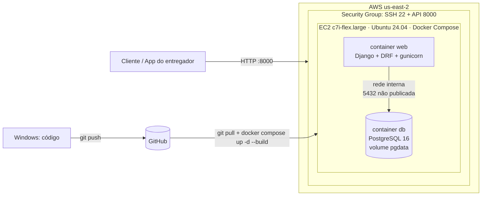
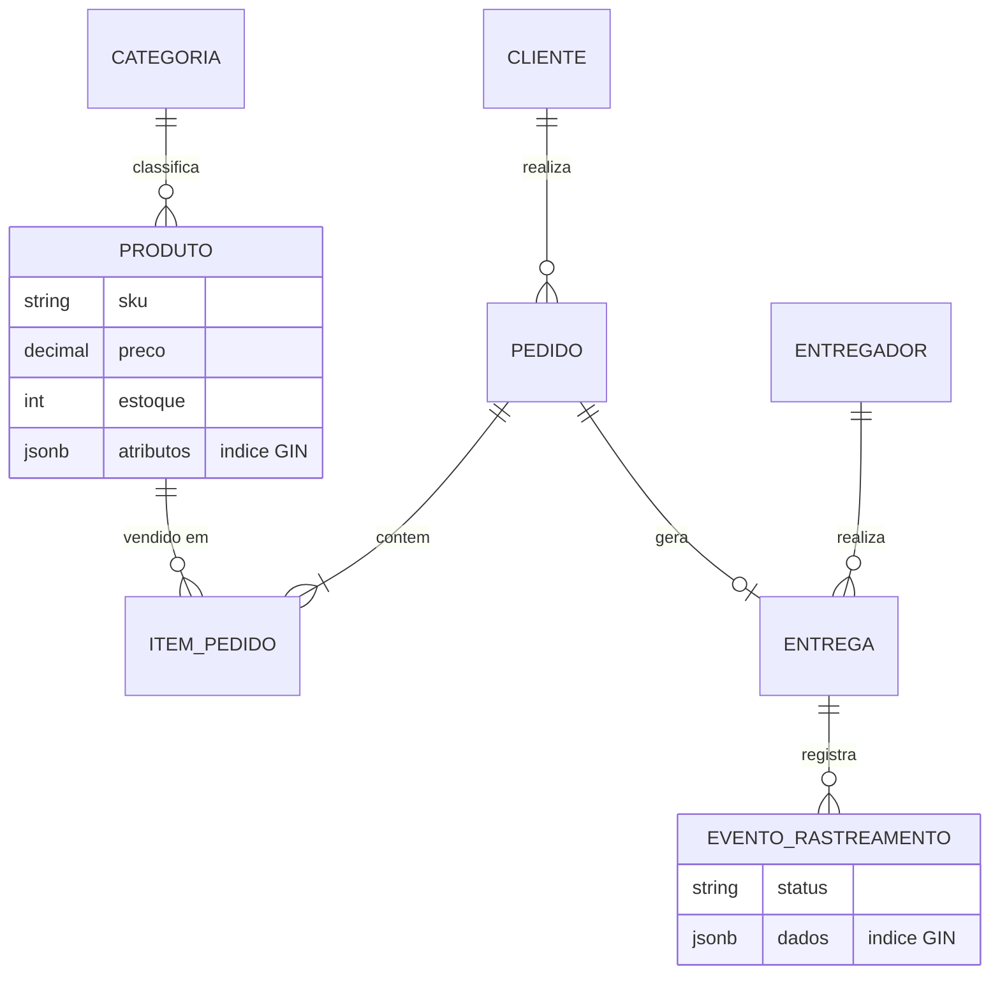

# Plataforma de E-commerce com Logística Last-Mile — Grupo IV

**Disciplina:** Projeto de Cloud — Ibmec · **Turma:** PC_ADS_26.2_8001
**Integrantes:** Ricardo França, Antonio Sinhorelli, Caio Araujo

API Django REST **multimodelo** (PostgreSQL relacional + JSONB) rodando em **Docker Compose numa
instância EC2**, com a documentação RUP (Iniciação, Elaboração e Transição) publicada em MkDocs.

## Links

| Item | Link |
|---|---|
| API publicada | <http://77.112.118.58:8000/api/> *(Elastic IP da EC2)* |
| Django Admin | <http://77.112.118.58:8000/admin/> |
| Health check | <http://77.112.118.58:8000/health/> |
| Site MkDocs (documentação) | <https://projetos-de-extensao.github.io/PC_ADS_26.2_8001_IV/> |
| Código da API, Dockerfile, docker-compose, seed e testes | <https://github.com/AntonioSinhorelli/pc_grupo4> |

## Arquitetura da solução

### Modelo de dados

**Decisões principais**

- **EC2 + Docker Compose** no lugar do Elastic Beanstalk: controle do ambiente e deploy reproduzível.
- **PostgreSQL em container** com volume nomeado `pgdata`: os dados sobrevivem a `docker compose down`/`up`.
- **Multimodelo no mesmo banco:** tabelas relacionais (ACID) para pedido e estoque; JSONB com índice GIN
  para atributos de produto e eventos de rastreamento.
- **Segredos fora do Git:** `.env` ignorado e `.env.example` versionado, sem senhas reais.
- **Postgres isolado:** o serviço `db` não publica portas; só o container `web` acessa o banco.

## Documentação (MkDocs)

| Fase | Documentos |
|---|---|
| Iniciação | [Documento de Visão](https://projetos-de-extensao.github.io/PC_ADS_26.2_8001_IV/Iniciacao/dv/) · [Requisitos Suplementares](https://projetos-de-extensao.github.io/PC_ADS_26.2_8001_IV/Iniciacao/rs/) |
| Elaboração | [Casos de Uso Arquiteturais](https://projetos-de-extensao.github.io/PC_ADS_26.2_8001_IV/Elaboracao/cua/) · [Pacotes/Subsistemas](https://projetos-de-extensao.github.io/PC_ADS_26.2_8001_IV/Elaboracao/maps/) · [Dimensionamento EC2](https://projetos-de-extensao.github.io/PC_ADS_26.2_8001_IV/Elaboracao/dim_comp/) · [Dimensionamento do Banco](https://projetos-de-extensao.github.io/PC_ADS_26.2_8001_IV/Elaboracao/dimrbd/) · [Sequência e Comunicação](https://projetos-de-extensao.github.io/PC_ADS_26.2_8001_IV/Elaboracao/seq_com/) |
| Transição | [Estratégias de Deploy](https://projetos-de-extensao.github.io/PC_ADS_26.2_8001_IV/Transicao/ativ_deploy/) |

Os arquivos-fonte ficam em [`docs/`](docs/) e o site é publicado automaticamente pelo GitHub Actions a cada push na `main`.

## Execução local, deploy na EC2 e evidências

O passo a passo de execução local, o deploy na EC2 (Windows → GitHub → EC2) e as evidências
(`docker ps`, `docker compose logs`, acesso à API, tabela no `psql` e teste de persistência) estão no
[README do repositório do código](https://github.com/AntonioSinhorelli/pc_grupo4#readme).
Os prints também estão em [`docs/assets/evidencias`](docs/assets/evidencias/).
