# Modelo de Design (Consolidação Arquitetural)

## Diagramas de Sequência e de Comunicação dos Fluxos Críticos

## Plataforma de E-commerce com Arquitetura de Nuvem Híbrida e Logística Last-Mile Inteligente

---

| **Informação do Documento** | |
| :--- | :--- |
| **Projeto** | Plataforma de E-commerce com Logística Last-Mile Inteligente |
| **Documento** | Modelo de Design (Sequência/Comunicação) - Consolidação Arquitetural |
| **Versão** | 1.0 |
| **Data** | 29/10/2026 |
| **Status** | Em Revisão |
| **Responsável** | Grupo E-commerce |
| **Disciplina** | Projeto de Cloud - Semana 7 |
| **Fase RUP/UP** | Elaboração (Elaboration) |

---

## 1. Introdução

### 1.1. Propósito

Este documento consolida a arquitetura da plataforma de e-commerce na AWS, mostrando **como os componentes definidos nos artefatos anteriores interagem** nos fluxos críticos do sistema. Cada fluxo é descrito por um diagrama de sequência (ordem temporal das mensagens) e um diagrama de comunicação (quem conversa com quem), acompanhados da tabela de mensagens e dos riscos.

O documento é derivado dos seguintes artefatos:

- **Documento de Visão** (Semana 1) - Funcionalidades principais e arquitetura AWS
- **Documento de Requisitos Suplementares** (Semana 2) - Metas de desempenho, disponibilidade, segurança e custo
- **Modelo de Casos de Uso Arquiteturais** (Semana 3) - UC-ARQ-001 a UC-ARQ-007
- **Modelo de Análise (Pacotes/Subsistemas)** (Semana 4) - Pacotes de segurança
- **Modelo de Análise (Classes) - RDS** (Semana 5) e **- EC2** (Semana 6) - Classes e premissas de carga

### 1.2. Escopo

Fluxos cobertos:

1. Checkout (criação do pedido e pagamento)
2. Ingestão de evento logístico (serverless)
3. Consulta de rastreamento do pedido
4. Autenticação e autorização por perfil (com MFA para o gestor)
5. Envio do comprovante de entrega (S3)
6. Failover do RDS (Multi-AZ)
7. Deploy automatizado (CI/CD Blue/Green)

**Fora do escopo:** análises de Big Data (EMR, Redshift), o detalhamento interno do gateway de pagamento (serviço de terceiros, conforme o Documento de Visão) e a interface gráfica.

### 1.3. Definições e Siglas

| **Sigla** | **Definição** |
| :--- | :--- |
| **ALB** | Application Load Balancer |
| **EC2** | Elastic Compute Cloud |
| **RDS** | Relational Database Service |
| **S3** | Simple Storage Service |
| **SNS** | Simple Notification Service (envio de alertas) |
| **KMS** | Key Management Service |
| **NAT** | Network Address Translation (saída das sub-redes privadas para a internet) |
| **CI/CD** | Continuous Integration / Continuous Delivery (integração e entrega contínuas) |
| **MFA** | Multi-Factor Authentication (autenticação multifator) |
| **TOTP** | Time-based One-Time Password (código de 6 dígitos do app autenticador) |
| **RBAC** | Role-Based Access Control (controle de acesso por perfil) |
| **ORM** | Object-Relational Mapping |
| **TTL** | Time To Live (expiração automática de itens no DynamoDB) |
| **p95** | Percentil 95 |
| **RPO / RTO** | Recovery Point Objective / Recovery Time Objective |
| **SLA** | Service Level Agreement |
| **LGPD** | Lei Geral de Proteção de Dados |
| **PCI-DSS** | Payment Card Industry Data Security Standard |

### 1.4. Referências

- Documento de Visão - E-commerce (v1.0)
- Documento de Requisitos Suplementares - E-commerce (v1.0)
- Modelo de Casos de Uso Arquiteturais - E-commerce (v1.0)
- Modelo de Análise (Pacotes/Subsistemas) - E-commerce (v1.0)
- Modelo de Análise (Classes) - RDS - E-commerce (v1.0)
- Modelo de Análise (Classes) - EC2 - E-commerce (v1.0)
- FOWLER, M. *UML Essencial* (UML Distilled)
- AWS Well-Architected Framework - Operational Excellence e Reliability Pillars

---

## 2. Visão Geral dos Fluxos Críticos

### 2.1. Mapa de Fluxos

| **Fluxo** | **Descrição** | **Ator** | **Componentes Principais** | **Prioridade** | **Requisitos** |
| :--- | :--- | :--- | :--- | :--- | :--- |
| **Fluxo 1** | Checkout (pedido + pagamento) | Cliente | ALB, EC2, RDS, Secrets Manager, NAT, gateway de pagamento | Crítica | < 2 s p95, 1.000 usuários, sem dados de cartão |
| **Fluxo 2** | Ingestão de evento logístico | App do entregador | API Gateway, Lambda, DynamoDB, SNS | Crítica | 100 ev/s (pico 500), < 80 ms p95 |
| **Fluxo 3** | Consulta de rastreamento | Cliente / Gestor | ALB, EC2, RDS, DynamoDB | Alta | < 2 s p95, separação de cargas |
| **Fluxo 4** | Autenticação e autorização | Cliente / Gestor | ALB, EC2 (Django auth), RDS | Alta | 3 perfis, MFA para o gestor |
| **Fluxo 5** | Envio do comprovante de entrega | App do entregador | API Gateway, Lambda, S3, KMS | Média | Criptografia, acesso restrito (LGPD) |
| **Fluxo 6** | Failover do RDS | Sistema AWS | RDS Primary/Standby, CloudWatch, SNS | Alta | RPO 15 min, RTO < 1 h |
| **Fluxo 7** | Deploy automatizado | Engenheiro de DevOps | GitHub, CodePipeline, CodeBuild, CodeDeploy, ALB | Média | Deploy < 10 min, rollback < 5 min |

### 2.2. Diagrama de Contexto Geral

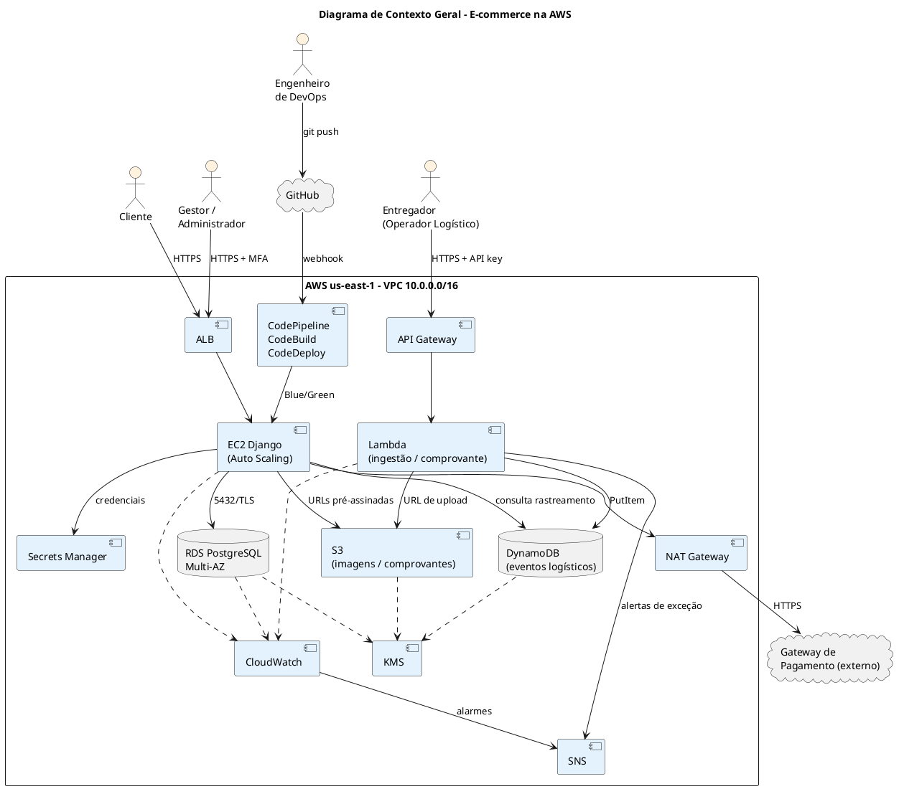

---

## 3. Especificação dos Fluxos

---

### 3.1. FLUXO 1: CHECKOUT (PEDIDO + PAGAMENTO)

#### 3.1.1. Descrição

O cliente confirma o carrinho. O Django, em uma **transação no RDS**, reserva o estoque e cria o pedido com status `AGUARDANDO_PAGAMENTO`. Em seguida, chama o **gateway de pagamento externo** (saída pela NAT Gateway) com o *token* do cartão gerado no navegador pelo próprio gateway. Assim, os dados completos do cartão **nunca passam pela plataforma** (RNF-SEG-06). Com a resposta, o pedido é atualizado para `PAGO` ou `PAGAMENTO_RECUSADO` e o estoque é liberado em caso de recusa.

#### 3.1.2. Requisitos Atendidos

| **Requisito** | **Valor** | **Fonte** |
| :--- | :--- | :--- |
| Tempo de resposta | < 2 s (p95) | RNF-PER-02 |
| Usuários simultâneos | ≥ 1.000 | RNF-PER-03 |
| Dados de cartão | Não armazenados (token do gateway) | RNF-SEG-06 |
| Credenciais do gateway | Secrets Manager | RNF-SEG-03 |
| Criptografia em trânsito | TLS 1.2+ | RNF-SEG-01 |
| Persistência | RDS | RNF-DAD-01 |

#### 3.1.3. Diagrama de Sequência

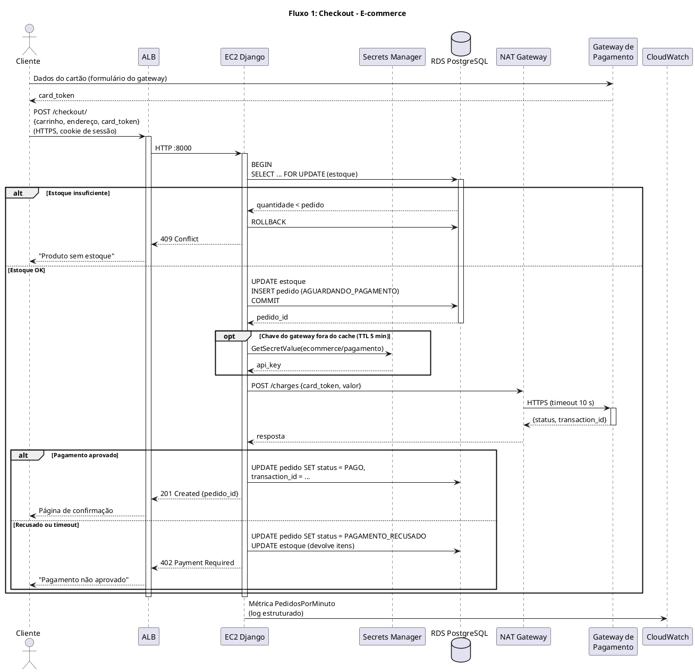

#### 3.1.4. Diagrama de Comunicação

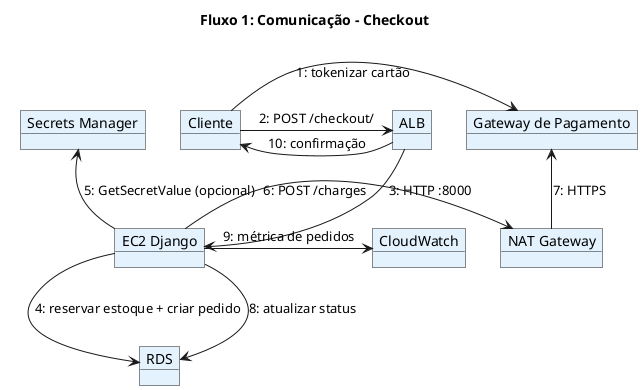

#### 3.1.5. Tabela de Mensagens

| **#** | **De** | **Para** | **Mensagem** | **Protocolo** | **Requisito** |
| :--- | :--- | :--- | :--- | :--- | :--- |
| 1 | Cliente | Gateway de pagamento | Tokenizar cartão | HTTPS | RNF-SEG-06 |
| 2 | Cliente | ALB | `POST /checkout/` | HTTPS (TLS 1.2+) | RNF-SEG-01 |
| 3 | ALB | EC2 | Encaminhar requisição | HTTP :8000 (rede privada) | RNF-PER-02 |
| 4 | EC2 | RDS | Transação: reservar estoque e inserir pedido | PostgreSQL/TLS :5432 | RNF-DAD-01 |
| 5 | EC2 | Secrets Manager | `GetSecretValue` (cache de 5 min) | HTTPS (VPC endpoint) | RNF-SEG-03 |
| 6-7 | EC2 | Gateway de pagamento | `POST /charges` via NAT | HTTPS | RNF-SEG-06 |
| 8 | EC2 | RDS | Atualizar status do pedido | PostgreSQL/TLS | RNF-DAD-01 |
| 9 | EC2 | CloudWatch | Métrica `PedidosPorMinuto` | HTTPS (agente) | RNF-OPS-01 |
| 10 | ALB | Cliente | `201 Created` / `402` / `409` | HTTPS | RNF-USA-03 |

#### 3.1.6. Riscos e Mitigações

| **Risco** | **Probabilidade** | **Impacto** | **Mitigação** |
| :--- | :--- | :--- | :--- |
| Gateway de pagamento lento ou fora do ar | Média | Alto | Timeout de 10 s, pedido fica `AGUARDANDO_PAGAMENTO` e é conciliado por webhook do gateway; alarme de taxa de recusa. |
| Venda do mesmo item duas vezes | Média | Alto | `SELECT ... FOR UPDATE` dentro da transação. |
| Cobrança duplicada por clique repetido | Média | Alto | Chave de idempotência (`pedido_id`) enviada ao gateway. |
| Falha de uma AZ da NAT Gateway | Baixa | Médio | Uma NAT Gateway por AZ (UC-ARQ-001). |
| Vazamento de dados de cartão | Baixa | Crítico | Tokenização no navegador; a plataforma guarda só `transaction_id` e status (escopo PCI-DSS reduzido). |

---

### 3.2. FLUXO 2: INGESTÃO DE EVENTO LOGÍSTICO (SERVERLESS)

#### 3.2.1. Descrição

O aplicativo do entregador envia eventos de status (coletado, em rota, entregue, tentativa frustrada) e de geolocalização. O **API Gateway** autentica pela *API key* e aplica *throttling*. A **Lambda** (associada às sub-redes privadas, UC-ARQ-004) valida o evento e grava no **DynamoDB** pelo VPC Gateway Endpoint, com TTL de 12 meses. Eventos de exceção geram alerta no **SNS** para o gestor (Sistema de Alertas do Documento de Visão). Esse fluxo **não toca o RDS** (RNF-ESC-03).

#### 3.2.2. Requisitos Atendidos

| **Requisito** | **Valor** | **Fonte** |
| :--- | :--- | :--- |
| Latência da ingestão | < 80 ms (p95) | RNF-PER-01 |
| Vazão | 100 eventos/s contínuos, pico de 500 eventos/s | RNF-PER-04 |
| Sem servidores dedicados | API Gateway + Lambda + DynamoDB | RNF-ESC-02 / RNF-CUS-04 |
| Separação de cargas | Eventos só no DynamoDB | RNF-ESC-03 |
| Retenção | 12 meses (TTL) | RNF-DAD-02 |
| Criptografia em repouso | DynamoDB com KMS | RNF-SEG-02 |

#### 3.2.3. Diagrama de Sequência

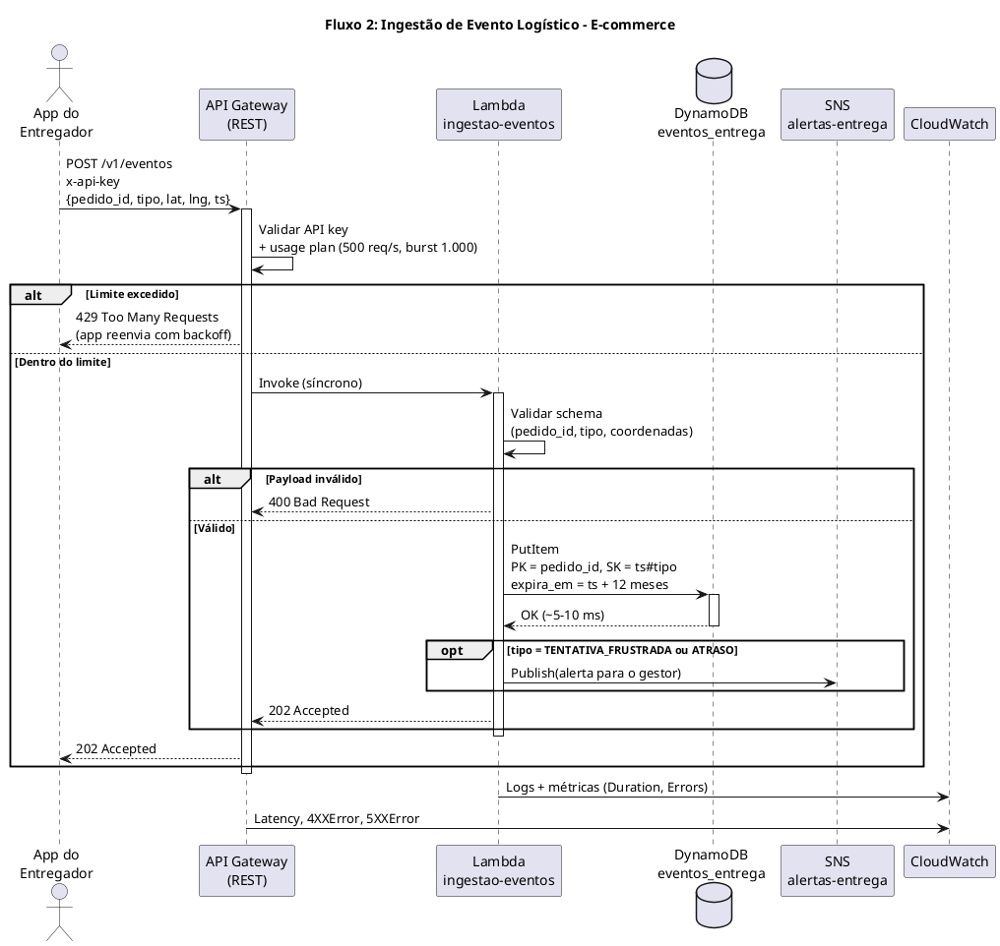

#### 3.2.4. Diagrama de Comunicação

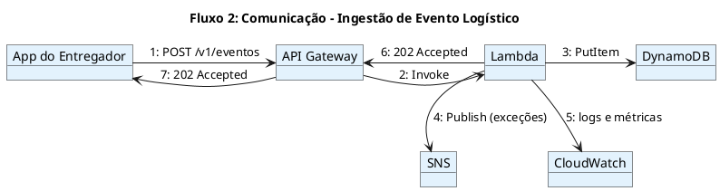

#### 3.2.5. Tabela de Mensagens

| **#** | **De** | **Para** | **Mensagem** | **Protocolo** | **Requisito** |
| :--- | :--- | :--- | :--- | :--- | :--- |
| 1 | App do entregador | API Gateway | `POST /v1/eventos` + `x-api-key` | HTTPS | RNF-PER-04, RNF-SEG-01 |
| 2 | API Gateway | Lambda | Invoke síncrono | Integração AWS | RNF-ESC-02 |
| 3 | Lambda | DynamoDB | `PutItem` com TTL | HTTPS (VPC Gateway Endpoint) | RNF-PER-01, RNF-DAD-02 |
| 4 | Lambda | SNS | `Publish` (somente exceções) | HTTPS | Visão: Sistema de Alertas |
| 5 | Lambda | CloudWatch | Logs e métricas | HTTPS | RNF-OPS-01/02 |
| 6-7 | Lambda → API Gateway → App | - | `202 Accepted` | HTTPS | RNF-PER-01 |

**Orçamento de latência (p95 < 80 ms):** API Gateway ~10 ms + Lambda aquecida ~15 ms + DynamoDB ~10 ms + rede ~20 ms ≈ **55 ms**.

#### 3.2.6. Riscos e Mitigações

| **Risco** | **Probabilidade** | **Impacto** | **Mitigação** |
| :--- | :--- | :--- | :--- |
| *Cold start* da Lambda na VPC ultrapassa 80 ms | Média | Médio | *Provisioned concurrency* de 5 instâncias (500 ev/s × 20 ms = 10 execuções simultâneas no pico; o restante escala sob demanda). |
| *Throttling* no pico | Baixa | Médio | Usage plan acima do pico (500 req/s); app guarda eventos offline e reenvia com backoff. |
| Evento duplicado (reenvio) | Média | Baixo | Chave `pedido_id + ts#tipo` torna o `PutItem` idempotente. |
| API key vazada | Baixa | Alto | Uma key por parceiro logístico, rotação e revogação no usage plan. |
| Crescimento ilimitado da tabela | Baixa | Médio | TTL de 12 meses (RNF-DAD-02); exportação para S3 antes da expiração (RNF-DAD-03). |

---

### 3.3. FLUXO 3: CONSULTA DE RASTREAMENTO DO PEDIDO

#### 3.3.1. Descrição

O cliente (ou o gestor) abre a página de rastreamento. O Django confirma no **RDS** que o pedido pertence ao usuário autenticado e busca no **DynamoDB** os eventos mais recentes daquele pedido. Os dois bancos ficam separados (RNF-ESC-03): o volume de eventos não afeta o desempenho do checkout.

#### 3.3.2. Requisitos Atendidos

| **Requisito** | **Valor** | **Fonte** |
| :--- | :--- | :--- |
| Tempo de resposta | < 2 s (p95) | RNF-PER-02 |
| Separação de cargas | RDS para pedidos, DynamoDB para eventos | RNF-ESC-03 |
| Controle de acesso | Cliente só vê os próprios pedidos | RNF-SEG-04 / RNF-SEG-07 |
| Painel em tempo quase real | Eventos disponíveis segundos após a ingestão | Documento de Visão |

#### 3.3.3. Diagrama de Sequência

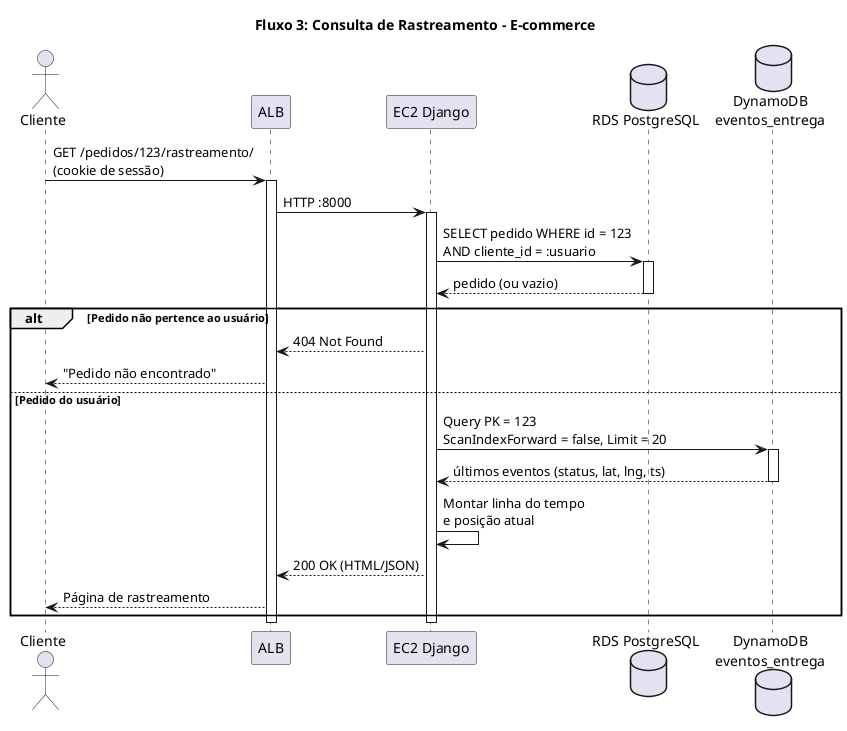

#### 3.3.4. Diagrama de Comunicação

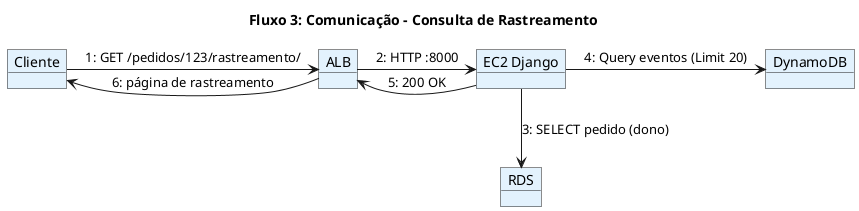

#### 3.3.5. Tabela de Mensagens

| **#** | **De** | **Para** | **Mensagem** | **Protocolo** | **Requisito** |
| :--- | :--- | :--- | :--- | :--- | :--- |
| 1 | Cliente | ALB | `GET /pedidos/{id}/rastreamento/` | HTTPS | RNF-SEG-01 |
| 2 | ALB | EC2 | Encaminhar requisição | HTTP :8000 | RNF-PER-02 |
| 3 | EC2 | RDS | Verificar dono do pedido | PostgreSQL/TLS | RNF-SEG-04 |
| 4 | EC2 | DynamoDB | `Query` por `pedido_id`, 20 itens mais recentes | HTTPS (VPC Gateway Endpoint) | RNF-ESC-03 |
| 5-6 | EC2 → ALB → Cliente | - | `200 OK` | HTTPS | RNF-PER-02 |

#### 3.3.6. Riscos e Mitigações

| **Risco** | **Probabilidade** | **Impacto** | **Mitigação** |
| :--- | :--- | :--- | :--- |
| Cliente acessar pedido de outro (IDOR) | Média | Alto | Filtro obrigatório por `cliente_id` na consulta ao RDS antes de ler o DynamoDB. |
| Atualização frequente da página gerar muitas leituras | Média | Baixo | `Limit = 20`, cache de 10 s no Django; DynamoDB on-demand. |
| DynamoDB indisponível | Baixa | Médio | Exibir o status do pedido do RDS com aviso "rastreamento temporariamente indisponível". |

---

### 3.4. FLUXO 4: AUTENTICAÇÃO E AUTORIZAÇÃO POR PERFIL

#### 3.4.1. Descrição

Clientes e gestores entram pelo portal. O Django valida a senha (hash Argon2 no RDS) e, para usuários do grupo **Gestor/Administrador**, exige um segundo fator **TOTP** (RNF-SEG-05). A sessão é gravada no RDS e o navegador recebe um cookie `Secure` e `HttpOnly`. A cada requisição, o Django verifica o **perfil** (grupos `Cliente`, `Gestor`, `OperadorLogistico`) antes de executar a view (RNF-SEG-04). O entregador não usa o portal: o aplicativo dele se autentica no API Gateway (Fluxo 2).

#### 3.4.2. Requisitos Atendidos

| **Requisito** | **Valor** | **Fonte** |
| :--- | :--- | :--- |
| Perfis de acesso | Cliente, Gestor/Administrador, Operador Logístico | RNF-SEG-04 |
| MFA | Obrigatório para contas administrativas | RNF-SEG-05 |
| Criptografia em trânsito | TLS 1.2+ | RNF-SEG-01 |
| Dados pessoais protegidos | Senha com hash, sessão em cookie seguro | RNF-SEG-07 |
| Rastreabilidade | Log de login e falhas | RNF-OPS-04 |

#### 3.4.3. Diagrama de Sequência

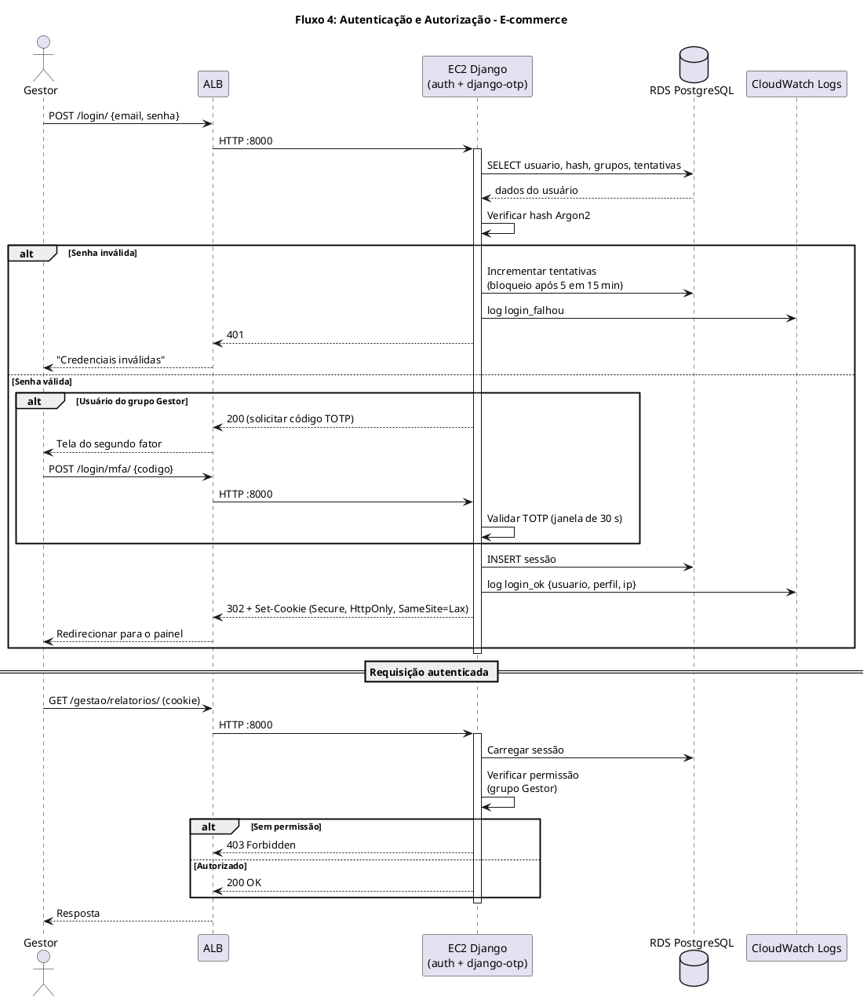

#### 3.4.4. Diagrama de Comunicação

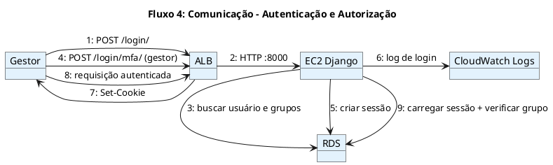

#### 3.4.5. Tabela de Mensagens

| **#** | **De** | **Para** | **Mensagem** | **Protocolo** | **Requisito** |
| :--- | :--- | :--- | :--- | :--- | :--- |
| 1-2 | Gestor → ALB → EC2 | - | `POST /login/` | HTTPS → HTTP :8000 | RNF-SEG-01 |
| 3 | EC2 | RDS | Buscar usuário, hash e grupos | PostgreSQL/TLS | RNF-SEG-07 |
| 4 | Gestor | ALB | `POST /login/mfa/` (código TOTP) | HTTPS | RNF-SEG-05 |
| 5 | EC2 | RDS | Criar sessão | PostgreSQL/TLS | - |
| 6 | EC2 | CloudWatch Logs | Evento de login | HTTPS | RNF-OPS-04 |
| 7 | ALB | Gestor | `302` + cookie seguro | HTTPS | RNF-SEG-07 |
| 8-9 | Gestor → EC2 → RDS | - | Requisição com verificação de perfil | HTTPS / PostgreSQL | RNF-SEG-04 |

#### 3.4.6. Riscos e Mitigações

| **Risco** | **Probabilidade** | **Impacto** | **Mitigação** |
| :--- | :--- | :--- | :--- |
| Ataque de força bruta | Alta | Alto | Bloqueio após 5 tentativas em 15 min; alarme de `login_falhou` no CloudWatch. |
| Roubo de sessão | Baixa | Alto | Cookie `Secure`, `HttpOnly`, `SameSite`; sessão expira em 2 h para gestores. |
| Gestor perde o app autenticador | Média | Médio | Códigos de recuperação de uso único gerados no cadastro do MFA. |
| Escalada de privilégio | Baixa | Crítico | Permissões por grupo testadas automaticamente no CodeBuild. |

---

### 3.5. FLUXO 5: ENVIO DO COMPROVANTE DE ENTREGA (S3)

#### 3.5.1. Descrição

Ao concluir a entrega, o aplicativo do entregador pede ao API Gateway uma **URL pré-assinada** de upload. A Lambda gera a URL (válida por 5 minutos, restrita a um único objeto) e o aplicativo envia a foto ou assinatura **diretamente ao S3**. O arquivo é criptografado com KMS e o bucket bloqueia acesso público. O comprovante contém dados pessoais (nome e assinatura de quem recebeu), por isso o acesso é restrito (LGPD).

#### 3.5.2. Requisitos Atendidos

| **Requisito** | **Valor** | **Fonte** |
| :--- | :--- | :--- |
| Armazenamento de arquivos | S3 | Documento de Visão / UC-ARQ-003 |
| Criptografia em repouso | SSE-KMS | RNF-SEG-02 |
| Criptografia em trânsito | HTTPS | RNF-SEG-01 |
| Acesso restrito a dados pessoais | Bucket privado, URL temporária | RNF-SEG-07 |
| Arquivamento | Lifecycle para classes mais baratas | RNF-DAD-03 |

#### 3.5.3. Diagrama de Sequência

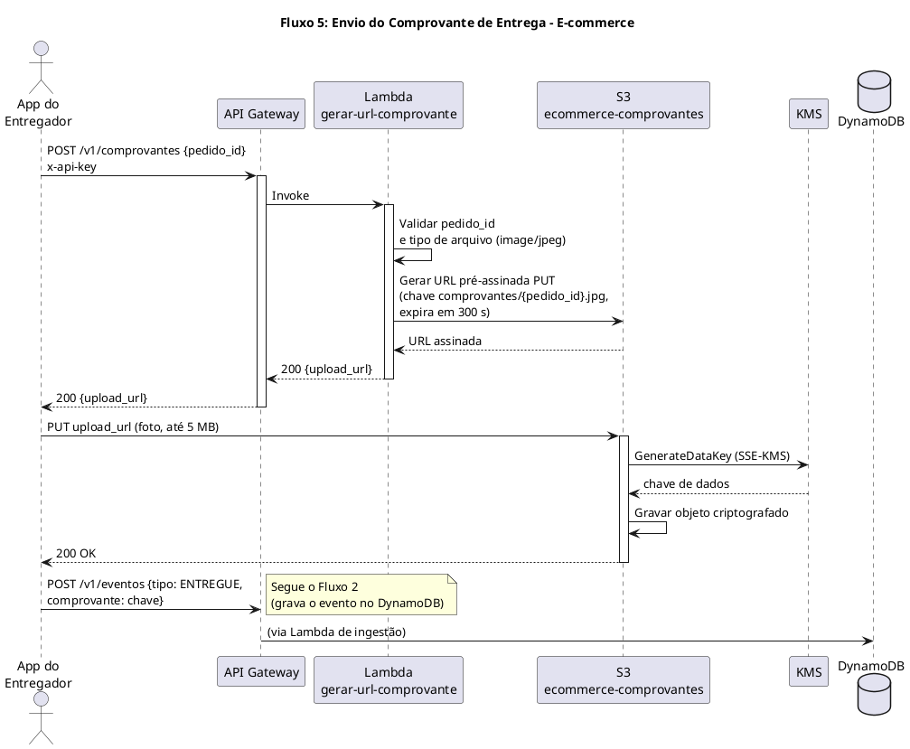

#### 3.5.4. Diagrama de Comunicação

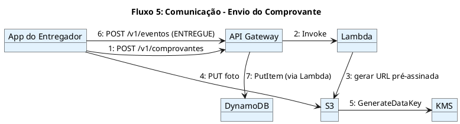

#### 3.5.5. Tabela de Mensagens

| **#** | **De** | **Para** | **Mensagem** | **Protocolo** | **Requisito** |
| :--- | :--- | :--- | :--- | :--- | :--- |
| 1 | App | API Gateway | `POST /v1/comprovantes` | HTTPS | RNF-SEG-01 |
| 2 | API Gateway | Lambda | Invoke | Integração AWS | RNF-ESC-02 |
| 3 | Lambda | S3 | Assinar URL de `PUT` (300 s) | Local (SDK) | RNF-SEG-07 |
| 4 | App | S3 | `PUT` do arquivo | HTTPS | RNF-SEG-01 |
| 5 | S3 | KMS | `GenerateDataKey` | Interno AWS | RNF-SEG-02 |
| 6-7 | App → API Gateway → DynamoDB | - | Evento `ENTREGUE` com referência ao arquivo | HTTPS | RNF-DAD-01 |

#### 3.5.6. Riscos e Mitigações

| **Risco** | **Probabilidade** | **Impacto** | **Mitigação** |
| :--- | :--- | :--- | :--- |
| URL pré-assinada reutilizada ou vazada | Baixa | Médio | Expira em 300 s, vale para uma única chave e tipo de arquivo. |
| Upload de arquivo malicioso ou grande | Média | Baixo | Tipo e tamanho fixados na assinatura; bucket sem execução de conteúdo. |
| Exposição pública de comprovantes | Baixa | Crítico | *Block Public Access* na conta, bucket policy exige TLS e KMS. |
| Custo de armazenamento crescente | Média | Baixo | Lifecycle: Standard-IA após 30 dias e Glacier após 180 dias. |

---

### 3.6. FLUXO 6: FAILOVER DO RDS (MULTI-AZ)

#### 3.6.1. Descrição

Se a instância primária ou a AZ `us-east-1a` falhar, o serviço RDS promove automaticamente a standby síncrona em `us-east-1b` e atualiza o DNS do endpoint. O Django reconecta usando o mesmo endpoint. O CloudWatch e o SNS **avisam** a equipe, mas não comandam o failover. Detalhes no documento de Dimensionamento do RDS (seção 5).

#### 3.6.2. Requisitos Atendidos

| **Requisito** | **Valor** | **Fonte** |
| :--- | :--- | :--- |
| Disponibilidade | 99,95% | RNF-DIS-01 |
| Redundância | RDS Multi-AZ | RNF-DIS-02 |
| RPO | ≤ 15 min (Multi-AZ: 0) | RNF-BCP-01 |
| RTO | < 1 h (failover: 1-2 min) | RNF-BCP-02 |
| Alarmes | Notificação de indisponibilidade | RNF-OPS-02 |

#### 3.6.3. Diagrama de Sequência

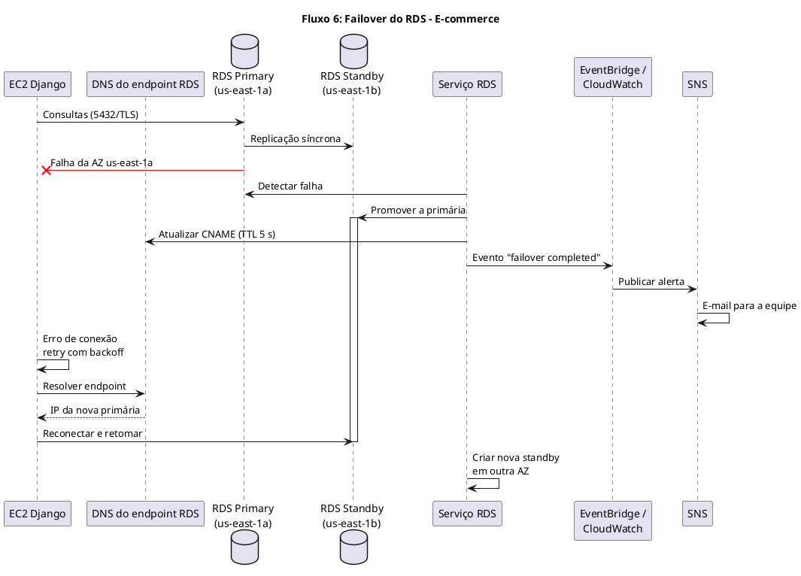

#### 3.6.4. Diagrama de Comunicação

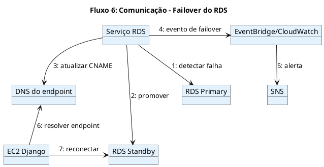

#### 3.6.5. Tabela de Mensagens

| **#** | **De** | **Para** | **Mensagem** | **Protocolo** | **Requisito** |
| :--- | :--- | :--- | :--- | :--- | :--- |
| 1 | Serviço RDS | RDS Primary | Monitoramento de saúde | Interno AWS | RNF-DIS-02 |
| 2 | Serviço RDS | RDS Standby | Promover a primária | Interno AWS | RNF-BCP-02 |
| 3 | Serviço RDS | DNS | Atualizar CNAME do endpoint | Interno AWS | RNF-BCP-02 |
| 4 | Serviço RDS | EventBridge/CloudWatch | Evento de failover | Interno AWS | RNF-OPS-02 |
| 5 | CloudWatch | SNS | Alerta para a equipe | HTTPS | RNF-OPS-02 |
| 6 | EC2 | DNS | Resolver endpoint | DNS | - |
| 7 | EC2 | Nova primária | Reconexão | PostgreSQL/TLS | RNF-DIS-01 |

#### 3.6.6. Riscos e Mitigações

| **Risco** | **Probabilidade** | **Impacto** | **Mitigação** |
| :--- | :--- | :--- | :--- |
| Aplicação guarda o IP antigo em cache | Baixa | Alto | Conexões com `CONN_HEALTH_CHECKS = True` no Django; sem cache de DNS na instância. |
| Erros 5xx durante o failover (1-2 min) | Alta (durante o evento) | Médio | Retry com backoff no Django; página amigável no checkout. |
| Health check do ALB derrubar todas as EC2 | Baixa | Alto | `/health/` não consulta o banco (documento de EC2, seção 3.4). |

---

### 3.7. FLUXO 7: DEPLOY AUTOMATIZADO (CI/CD BLUE/GREEN)

#### 3.7.1. Descrição

Um merge na branch `main` do GitHub dispara o **CodePipeline**. O **CodeBuild** instala dependências e roda os testes. Após **aprovação manual** (UC-ARQ-006), o **CodeDeploy** cria uma cópia do Auto Scaling Group (ambiente *green*) com a nova versão. Quando ela passa no health check, o CodeDeploy troca o tráfego do ALB do *blue* para o *green*. O ambiente *blue* fica disponível por 15 minutos para rollback rápido. Detalhes no documento de Estratégias de Deploy.

#### 3.7.2. Requisitos Atendidos

| **Requisito** | **Valor** | **Fonte** |
| :--- | :--- | :--- |
| Pipeline integrado ao repositório | CodePipeline + GitHub | RNF-MAN-03 |
| Tempo de deploy | < 10 min | UC-ARQ-006 |
| Tempo de rollback | < 5 min | UC-ARQ-006 |
| Sem indisponibilidade no deploy | Blue/Green | RNF-DIS-01 |
| Falha de build notificada | SNS | UC-ARQ-006 (Alt 1) |

#### 3.7.3. Diagrama de Sequência

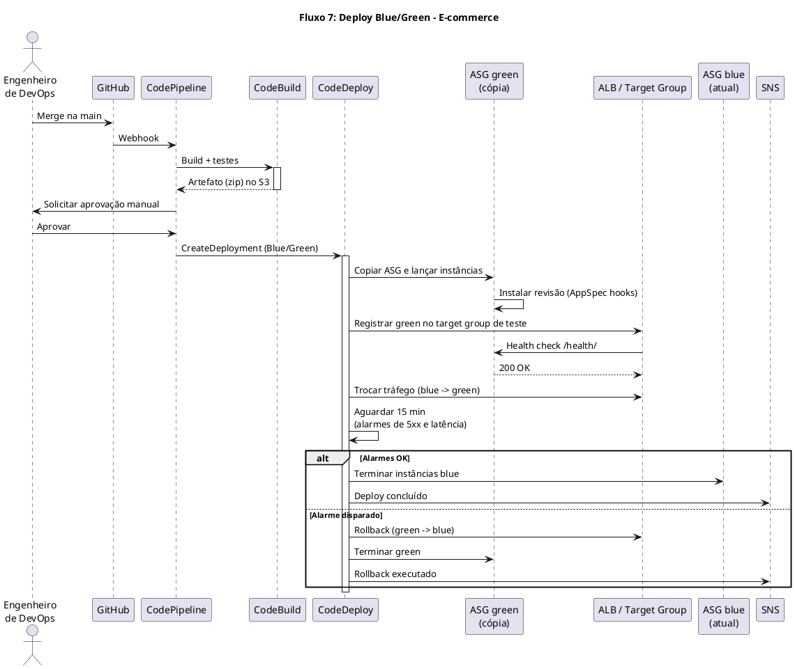

#### 3.7.4. Diagrama de Comunicação

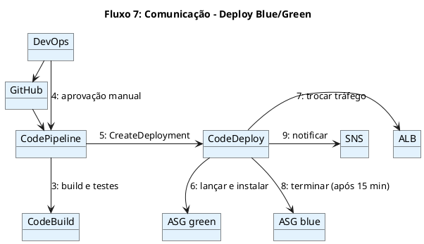

#### 3.7.5. Tabela de Mensagens

| **#** | **De** | **Para** | **Mensagem** | **Protocolo** | **Requisito** |
| :--- | :--- | :--- | :--- | :--- | :--- |
| 1-2 | DevOps → GitHub → CodePipeline | - | Merge e webhook | HTTPS | RNF-MAN-01/03 |
| 3 | CodePipeline | CodeBuild | Executar `buildspec.yml` | Interno AWS | UC-ARQ-006 |
| 4 | DevOps | CodePipeline | Aprovação manual | Console AWS | UC-ARQ-006 |
| 5 | CodePipeline | CodeDeploy | `CreateDeployment` | Interno AWS | UC-ARQ-006 |
| 6 | CodeDeploy | ASG green | Copiar ASG e instalar revisão | Interno AWS | RNF-DIS-01 |
| 7 | CodeDeploy | ALB | Trocar target group do listener | Interno AWS | Deploy < 10 min |
| 8 | CodeDeploy | ASG blue | Terminar instâncias antigas | Interno AWS | RNF-CUS-03 |
| 9 | CodeDeploy | SNS | Notificar resultado | HTTPS | UC-ARQ-006 (Alt 1/2) |

#### 3.7.6. Riscos e Mitigações

| **Risco** | **Probabilidade** | **Impacto** | **Mitigação** |
| :--- | :--- | :--- | :--- |
| Migração de banco incompatível com a versão anterior | Média | Alto | Migrações compatíveis com as duas versões (expandir, depois contrair) e snapshot manual antes. |
| Deploy durante pico sazonal | Baixa | Alto | Congelamento de deploys em dias de campanha. |
| Aprovação manual atrasar o deploy | Média | Baixo | Tempo de deploy medido a partir da aprovação. |

---

## 4. Diagrama de Classes Consolidado

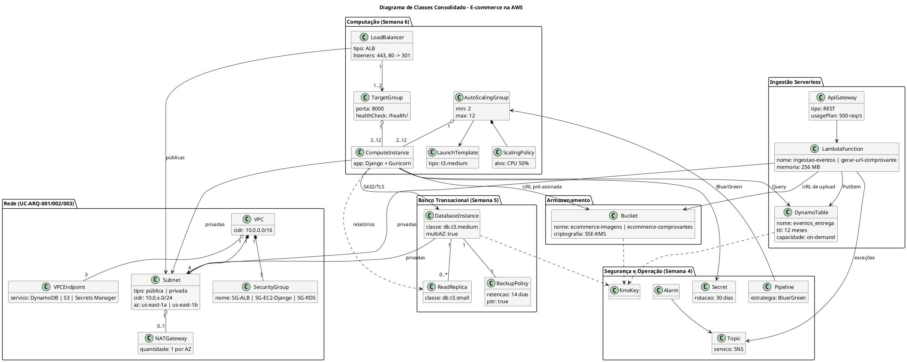

---

## 5. Matriz de Rastreamento Consolidada

| **Fluxo** | **Requisito** | **Caso de Uso** | **Pacote** | **Classes** | **Serviços AWS** |
| :--- | :--- | :--- | :--- | :--- | :--- |
| Fluxo 1 - Checkout | RNF-PER-02/03, RNF-SEG-03/06 | UC-ARQ-004, UC-ARQ-007 | Secrets Management, Data Protection | `LoadBalancer`, `ComputeInstance`, `DatabaseInstance`, `Secret` | ALB, EC2, RDS, Secrets Manager, NAT Gateway |
| Fluxo 2 - Ingestão | RNF-PER-01/04, RNF-ESC-02/03, RNF-DAD-02 | UC-ARQ-003, UC-ARQ-004 | Data Protection, Monitoring & Detection | `ApiGateway`, `LambdaFunction`, `DynamoTable` | API Gateway, Lambda, DynamoDB, SNS |
| Fluxo 3 - Rastreamento | RNF-PER-02, RNF-ESC-03, RNF-SEG-04 | UC-ARQ-003, UC-ARQ-004 | Identity & Access | `ComputeInstance`, `DatabaseInstance`, `DynamoTable` | ALB, EC2, RDS, DynamoDB |
| Fluxo 4 - Autenticação | RNF-SEG-01/04/05/07, RNF-OPS-04 | UC-ARQ-002, UC-ARQ-007 | Identity & Access, Audit & Compliance | `ComputeInstance`, `DatabaseInstance` | ALB, EC2, RDS, CloudWatch Logs |
| Fluxo 5 - Comprovante | RNF-SEG-01/02/07, RNF-DAD-03 | UC-ARQ-003, UC-ARQ-007 | Data Protection | `LambdaFunction`, `Bucket`, `KmsKey` | API Gateway, Lambda, S3, KMS |
| Fluxo 6 - Failover RDS | RNF-DIS-01/02, RNF-BCP-01/02, RNF-OPS-02 | UC-ARQ-004, UC-ARQ-005 | Data Protection, Monitoring & Detection | `DatabaseInstance`, `BackupPolicy`, `Alarm` | RDS Multi-AZ, CloudWatch, SNS |
| Fluxo 7 - Deploy | RNF-MAN-01/03, RNF-DIS-01 | UC-ARQ-006 | Audit & Compliance | `Pipeline`, `AutoScalingGroup`, `TargetGroup` | CodePipeline, CodeBuild, CodeDeploy, ALB |

### 5.1. Orçamento Consolidado

Soma das estimativas dos documentos de RDS e EC2 com os demais serviços usados nos fluxos. Preços de referência sob demanda em us-east-1.

| **Componente** | **Base da estimativa** | **Custo Mensal** |
| :--- | :--- | :--- |
| RDS (primária Multi-AZ + réplica + backup) | Documento de RDS, seção 7.4 | US$ 150,78 |
| EC2 + ALB + saída de dados do portal | Documento de EC2, seção 8.4 | US$ 357,41 |
| NAT Gateway | 2 (1 por AZ) × US$ 0,045 × 730 h | US$ 65,70 |
| VPC Interface Endpoints | S3 e Secrets Manager, 2 AZs × US$ 0,01 × 730 h | US$ 29,20 |
| API Gateway (REST) | ~12,3 milhões de eventos/mês × US$ 3,50/milhão | US$ 43,05 |
| Lambda | Requisições + execução + 5 de *provisioned concurrency* | US$ 17,00 |
| DynamoDB (on-demand) | Escritas, leituras, armazenamento e PITR | US$ 25,00 |
| S3 | Imagens e comprovantes + saída de imagens (com cache no navegador) | US$ 110,00 |
| CloudWatch | Logs com retenção de 90 dias, alarmes e dashboard | US$ 25,00 |
| KMS | 3 chaves + requisições | US$ 4,00 |
| CodePipeline / CodeBuild / CodeDeploy | Documento de Deploy, seção 6 | US$ 2,20 |
| Route 53 | 1 zona hospedada + consultas | US$ 1,50 |
| Secrets Manager (chave do gateway) | 1 segredo adicional | US$ 0,40 |
| **TOTAL** | | **~US$ 831/mês** |

**Percentual do orçamento:** ~US$ 831 ÷ US$ 1.500 = **~55%**. A folga de ~US$ 670 cobre meses com mais campanhas sazonais e erros nas premissas de carga. Duas otimizações já identificadas: usar **Gateway Endpoint** (gratuito) para o S3 no lugar do Interface Endpoint (-US$ 14,60) e colocar o **CloudFront** à frente do ALB e do S3 (redução estimada de ~US$ 90 a US$ 150 na saída de dados).

---

## 6. Considerações Finais

### 6.1. Lições Aprendidas

- Os diagramas de sequência mostraram que **o RDS só é acessado pelo Django**: a ingestão logística (Fluxos 2 e 5) é totalmente serverless, cumprindo o RNF-ESC-03.
- O checkout depende de um **serviço externo**, o gateway de pagamento. Timeout, idempotência e conciliação por webhook são tão importantes quanto a infraestrutura AWS.
- A **disponibilidade composta** dos componentes em série (ALB 99,99% × EC2 em várias AZs 99,99% × RDS Multi-AZ 99,95%) é de cerca de **99,93%**, um pouco abaixo da meta de 99,95%. Os SLAs da AWS são valores mínimos contratuais e a disponibilidade real costuma ser maior, mas a meta deve ser **acompanhada por métricas** (RNF-DIS-01) e não apenas presumida.
- Em vários fluxos o CloudWatch e o SNS **observam e avisam**, mas quem age é o serviço gerenciado (RDS no failover, ASG na substituição de instâncias, CodeDeploy no rollback).
- O custo total estimado (~55% do orçamento) é dominado pela **transferência de dados**, não pelos servidores.

### 6.2. Próximos Passos

- **Semana 10:** Modelo de Design (Atividades) - estratégias de deploy (Blue/Green, Canary e Rolling).
- Implementar o pipeline do Fluxo 7 e o teste de carga do Fluxo 1 com 1.000 usuários simultâneos.
- Avaliar a adoção do CloudFront e a troca do Interface Endpoint do S3 por Gateway Endpoint.
- Corrigir a matriz de rastreamento do Modelo de Pacotes, que cita casos de uso inexistentes (UC-ARQ-008 a 010).

---

## 7. Aprovações

| **Função** | **Nome** | **Data** | **Assinatura** |
| :--- | :--- | :--- | :--- |
| Arquiteto de Soluções | | | |
| Arquiteto de Design | | | |
| Professor Responsável | | | |
| Coordenador do Curso | | | |

---

## 8. Histórico de Versões

| **Versão** | **Data** | **Autor** | **Descrição das Alterações** |
| :--- | :--- | :--- | :--- |
| 0.1 | 29/10/2026 | Grupo E-commerce | Criação do documento a partir do modelo SwiftTrack. |
| 1.0 | 29/10/2026 | Grupo E-commerce | Sete fluxos do e-commerce com diagramas, diagrama de classes consolidado, matriz e orçamento consolidado. |
