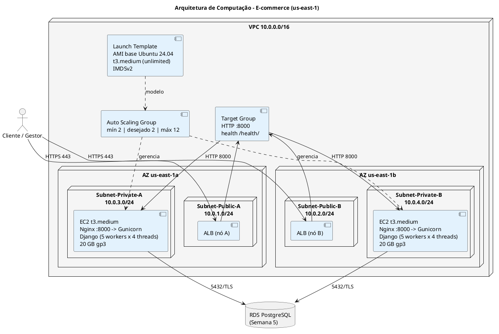
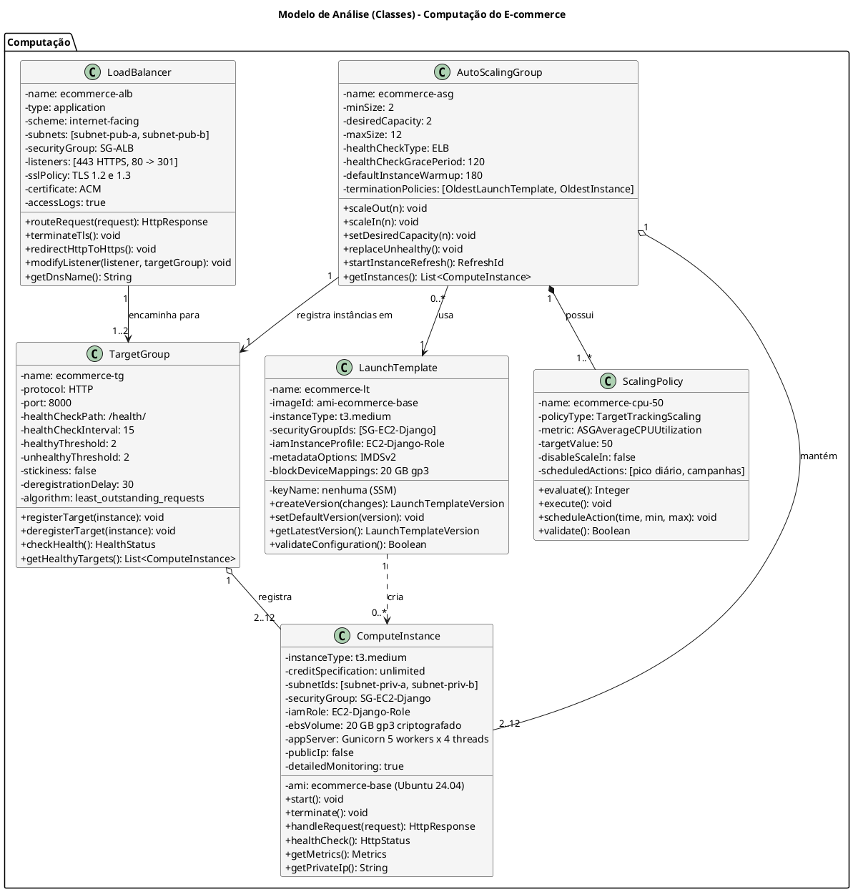
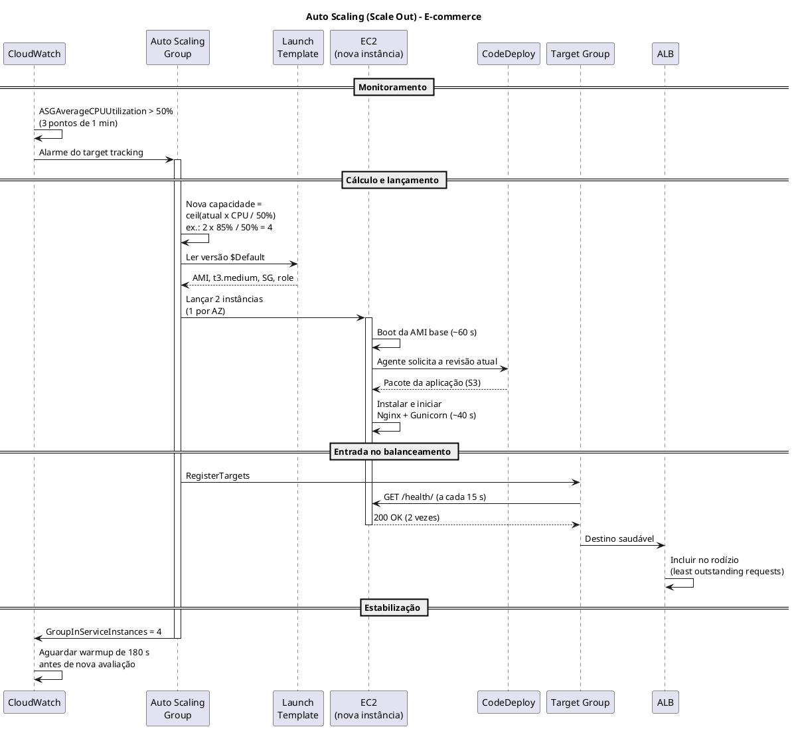
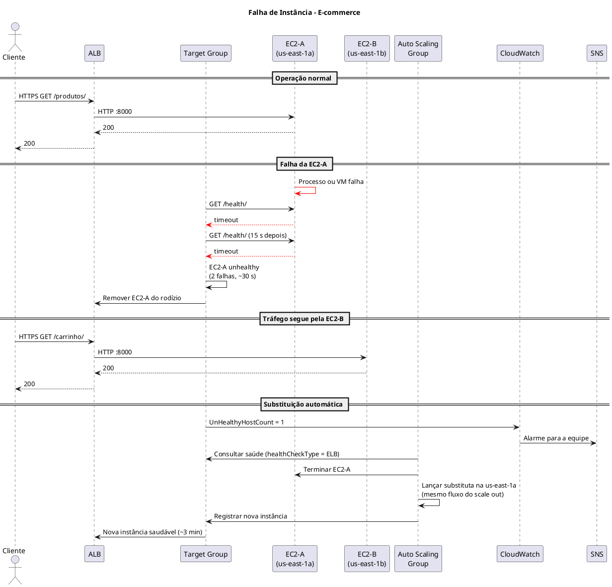
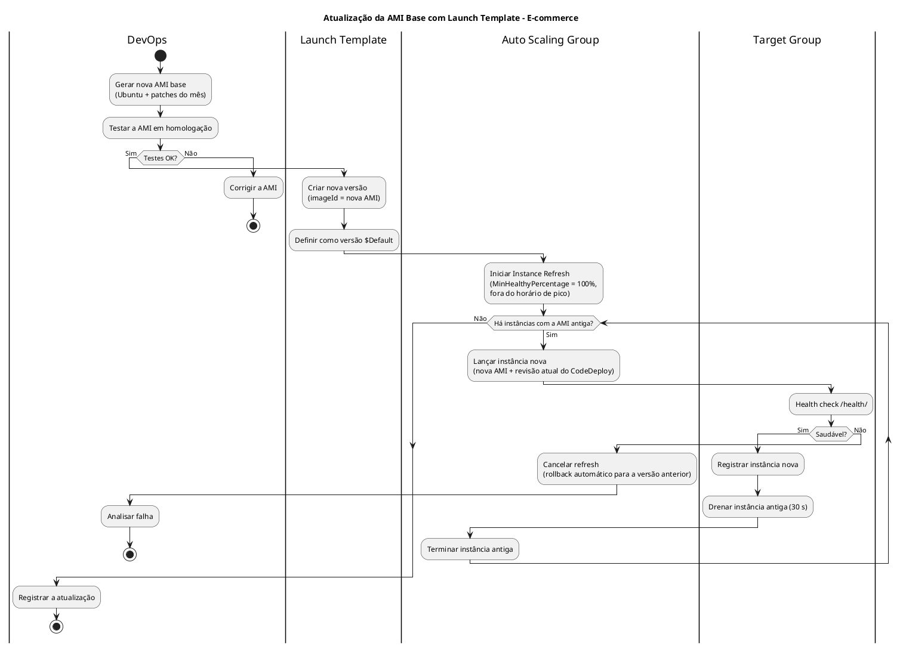

# Modelo de Análise (Classes de Análise)

## Dimensionamento de Computação (EC2)

## Plataforma de E-commerce com Arquitetura de Nuvem Híbrida e Logística Last-Mile Inteligente

---

| **Informação do Documento** | |
| :--- | :--- |
| **Projeto** | Plataforma de E-commerce com Logística Last-Mile Inteligente |
| **Documento** | Modelo de Análise (Classes de Análise) - Dimensionamento de Computação (EC2) |
| **Versão** | 1.0 |
| **Data** | 29/10/2026 |
| **Status** | Em Revisão |
| **Responsável** | Grupo E-commerce |
| **Disciplina** | Projeto de Cloud - Semana 6 |
| **Fase RUP/UP** | Elaboração (Elaboration) |

---

## 1. Introdução

### 1.1. Propósito

Este documento apresenta o **Modelo de Análise (Classes de Análise)** para o dimensionamento da camada de computação **Amazon EC2** da plataforma de e-commerce. Essa camada executa o portal e a API transacional em Django (catálogo, carrinho, pedidos, pagamentos e painel do gestor). O documento descreve as classes de análise da camada, seus atributos e relacionamentos, e justifica o tipo e a quantidade de instâncias a partir dos requisitos não funcionais.

O modelo é derivado diretamente dos seguintes artefatos:

- **Documento de Visão** (Semana 1) - Seções "Recursos do Produto (Arquitetura AWS)" e "Atributos de Qualidade"
- **Documento de Requisitos Suplementares** (Semana 2) - RNF-PER-02/03/05, RNF-ESC-01, RNF-DIS-01/02/03, RNF-CUS-01/03
- **Modelo de Casos de Uso Arquiteturais** (Semana 3) - UC-ARQ-001 (VPC), UC-ARQ-002 (Security Groups), UC-ARQ-004 (Conectividade) e UC-ARQ-006 (CI/CD)
- **Modelo de Análise (Pacotes/Subsistemas)** (Semana 4) - Pacotes "Network Security", "Identity & Access" e "Data Protection"
- **Modelo de Análise (Classes) - RDS** (Semana 5) - Limite de conexões e premissas de carga

### 1.2. Escopo

O modelo abrange o dimensionamento da camada de computação EC2, incluindo:

- **Instância de computação** (`ComputeInstance`) que executa o Django
- **Auto Scaling Group** (`AutoScalingGroup`) para escalabilidade automática
- **Application Load Balancer** (`LoadBalancer`) para distribuição de carga e terminação TLS
- **Target Group** (`TargetGroup`) para registro e health check das instâncias
- **Launch Template** (`LaunchTemplate`) para padronizar as instâncias
- **Políticas de escalonamento** (`ScalingPolicy`) por métrica e por agendamento
- **Memória de cálculo** (vCPU, memória, número de instâncias, disponibilidade)
- **Estimativa de custo** e comparação com alternativas

**Fora do escopo:** NAT Gateway e demais componentes de rede (UC-ARQ-001), a camada serverless de ingestão de eventos logísticos (API Gateway + Lambda + DynamoDB) e o RDS (documento da Semana 5).

### 1.3. Definições e Siglas

| **Sigla** | **Definição** |
| :--- | :--- |
| **EC2** | Elastic Compute Cloud (máquinas virtuais da AWS) |
| **ALB** | Application Load Balancer (balanceador de carga de camada 7) |
| **ASG** | Auto Scaling Group (grupo que ajusta a quantidade de instâncias) |
| **AMI** | Amazon Machine Image (imagem de disco usada para criar instâncias) |
| **EBS** | Elastic Block Store (disco das instâncias) |
| **LCU** | Load Balancer Capacity Unit (unidade de cobrança do ALB) |
| **ACM** | AWS Certificate Manager (certificados TLS gratuitos) |
| **IMDSv2** | Instance Metadata Service versão 2 (metadados da instância com proteção contra SSRF) |
| **SSM** | AWS Systems Manager (acesso administrativo sem SSH) |
| **WSGI** | Web Server Gateway Interface (interface entre o Gunicorn e o Django) |
| **p95** | Percentil 95 (95% das requisições abaixo do valor) |
| **SLA** | Service Level Agreement (acordo de nível de serviço) |
| **RTO / RPO** | Recovery Time Objective / Recovery Point Objective |
| **SG** | Security Group (firewall de instância) |
| **LGPD** | Lei Geral de Proteção de Dados (Lei nº 13.709/2018) |

### 1.4. Referências

- Documento de Visão - E-commerce (v1.0)
- Documento de Requisitos Suplementares - E-commerce (v1.0)
- Modelo de Casos de Uso Arquiteturais - E-commerce (v1.0)
- Modelo de Análise (Pacotes/Subsistemas) - E-commerce (v1.0)
- Modelo de Análise (Classes) - RDS - E-commerce (v1.0)
- Amazon EC2 Auto Scaling - User Guide
- Elastic Load Balancing - Application Load Balancers
- Amazon EC2 / ELB Pricing (região us-east-1)
- AWS Well-Architected Framework - Performance Efficiency e Cost Optimization Pillars

---

## 2. Visão Geral do Dimensionamento

### 2.1. Premissas de Carga

Mesmas premissas do documento de RDS (seção 2.1 daquele documento), mais as específicas da camada de aplicação.

| **ID** | **Premissa** | **Valor** | **Origem** |
| :--- | :--- | :--- | :--- |
| P-01 | Usuários simultâneos no pico diário | 1.000 | RNF-PER-03 |
| P-02 | Intervalo médio entre requisições dinâmicas de um usuário | 5 s | Estimativa do grupo |
| P-03 | Requisições dinâmicas no pico diário | **200 req/s** | 1.000 ÷ 5 |
| P-04 | Pico sazonal (promoções, Black Friday) | 3× → **600 req/s** | Estimativa do grupo |
| P-10 | CPU por requisição dinâmica (Django + ORM + template) | ~20 ms | Estimativa do grupo |
| P-11 | Perfil diário de tráfego | 2 h de pico (200 req/s), 12 h moderadas (60 req/s), 10 h baixas (10 req/s) | Estimativa do grupo |
| P-12 | Tamanho médio de resposta (HTML/JSON comprimido) | 20 KB | Estimativa; imagens servidas pelo S3 |
| P-13 | Eventos sazonais por mês | 2 dias, 6 h cada | Estimativa do grupo |

### 2.2. Requisitos que Impactam o Dimensionamento

| **Requisito** | **Valor** | **Fonte** |
| :--- | :--- | :--- |
| **Usuários simultâneos** | ≥ 1.000 | RNF-PER-03 |
| **Tempo de resposta do portal** | < 2 s (p95) | RNF-PER-02 |
| **Erros HTTP 5xx** | < 1% | RNF-PER-05 |
| **Auto Scaling nas instâncias Django** | Obrigatório | RNF-ESC-01 |
| **Disponibilidade** | ≥ 99,95% | RNF-DIS-01 |
| **Distribuição em 2 AZs** | Obrigatória | RNF-DIS-02 |
| **Falha de uma instância não derruba o portal** | Obrigatório | RNF-DIS-03 |
| **Redução da capacidade em baixa utilização** | Obrigatória | RNF-CUS-03 |
| **HTTPS com TLS 1.2+** | Obrigatório | RNF-SEG-01 |
| **Orçamento total** | US$ 1.500/mês | RNF-CUS-01 |
| **Orçamento alocado a EC2 + ALB + tráfego** | US$ 400/mês (27% do total) | Decisão do grupo |

### 2.3. Arquitetura de Computação

### 2.4. Matriz de Rastreamento

| **Requisito (Doc. Suplementar)** | **Pacote (Semana 4)** | **Classe de Análise** | **Serviço AWS** | **Configuração** |
| :--- | :--- | :--- | :--- | :--- |
| RNF-PER-02 < 2 s (p95) | - | `ComputeInstance` | EC2 | `t3.medium`, CPU-alvo de 50% |
| RNF-PER-03 1.000 usuários | - | `AutoScalingGroup` | EC2 Auto Scaling | 4 instâncias no pico diário |
| RNF-ESC-01 Auto Scaling | - | `ScalingPolicy` | EC2 Auto Scaling | *Target tracking* de CPU 50% + agendamento |
| RNF-DIS-01/02 99,95% em 2 AZs | Network Security | `AutoScalingGroup` / `LoadBalancer` | ASG + ALB | Mínimo 2 instâncias, 1 por AZ |
| RNF-DIS-03 Falha de instância | Monitoring & Detection | `TargetGroup` | ALB | Health check retira a instância em ~30 s |
| RNF-CUS-03 Reduzir em baixa | - | `ScalingPolicy` | EC2 Auto Scaling | *Scale in* automático até 2 |
| RNF-SEG-01 TLS 1.2+ | Data Protection | `LoadBalancer` | ALB + ACM | Política `ELBSecurityPolicy-TLS13-1-2-2021-06` |
| RNF-SEG-03 Credenciais | Secrets Management | `LaunchTemplate` | IAM Role + Secrets Manager | Instância lê o segredo pela role |
| RNF-SEG-05 Acesso privilegiado | Identity & Access | `LaunchTemplate` | SSM Session Manager | Sem chave SSH e sem IP público |
| RNF-OPS-01 Monitoramento | Monitoring & Detection | `ComputeInstance` | CloudWatch | Monitoramento detalhado (1 min) |
| RNF-MAN-03 CI/CD | Audit & Compliance | `LaunchTemplate` / `AutoScalingGroup` | CodeDeploy | Blue/Green (documento de Deploy) |

---

## 3. Especificação das Classes de Análise

---

### 3.1. Classe: COMPUTEINSTANCE

#### 3.1.1. Responsabilidade

Representar a instância EC2 que executa o portal e a API transacional do e-commerce (Nginx → Gunicorn → Django), atendendo às requisições encaminhadas pelo ALB e acessando o RDS, o DynamoDB (consulta de rastreamento), o S3 (imagens) e o Secrets Manager.

#### 3.1.2. Atributos

| **Atributo** | **Tipo** | **Valor (E-commerce)** | **Justificativa** |
| :--- | :--- | :--- | :--- |
| `instanceType` | String | `t3.medium` | 2 vCPU, 4 GB RAM; 50 req/s por instância a 50% de CPU (seção 8.1). |
| `creditSpecification` | String | `unlimited` | Os picos acima da linha de base (20%) são cobrados, sem estrangular a CPU. |
| `ami` | String | `ecommerce-base` (Ubuntu 24.04 LTS) | AMI pré-configurada com Python 3.12, Nginx, Gunicorn e agentes, para iniciar em ~2 min. |
| `vpcId` | String | `vpc-ecommerce` (10.0.0.0/16) | VPC do projeto (UC-ARQ-001). |
| `subnetIds` | List&lt;String&gt; | `subnet-priv-a` (10.0.3.0/24), `subnet-priv-b` (10.0.4.0/24) | O ASG distribui as instâncias entre as duas AZs. |
| `securityGroup` | SecurityGroup | `SG-EC2-Django` | Entrada somente na porta 8000 a partir do `SG-ALB` (UC-ARQ-002). |
| `iamRole` | String | `EC2-Django-Role` | Ler o segredo do RDS, consultar o DynamoDB de rastreamento, gerar URLs pré-assinadas no S3, enviar logs ao CloudWatch e usar o SSM. |
| `ebsVolume` | String | 20 GB gp3, criptografado | SO, ambiente Python e logs locais (os logs vão para o CloudWatch). |
| `appServer` | String | Gunicorn, 5 workers × 4 threads (`gthread`) | 2 × vCPU + 1 workers; até 20 requisições simultâneas por instância. |
| `publicIp` | Boolean | `false` | Acesso de usuários apenas pelo ALB. |
| `detailedMonitoring` | Boolean | `true` | Métricas a cada 1 min para o Auto Scaling reagir mais rápido. |
| `ebsOptimized` | Boolean | `true` | Padrão do t3. |

#### 3.1.3. Responsabilidades (Métodos)

| **Responsabilidade** | **Descrição** | **Retorno** |
| :--- | :--- | :--- |
| `start()` | Inicia a instância. | `void` |
| `terminate()` | Encerra a instância (feito pelo ASG). | `void` |
| `handleRequest(request)` | Processa uma requisição HTTP do ALB. | `HttpResponse` |
| `healthCheck()` | Responde em `/health/` se o processo Django está ativo. | `HttpStatus` |
| `getMetrics()` | Retorna CPU, memória (agente CloudWatch), rede e créditos de CPU. | `Metrics` |
| `getPrivateIp()` | Retorna o IP privado. | `String` |

#### 3.1.4. Relacionamentos

| **Relacionamento** | **Multiplicidade** | **Descrição** |
| :--- | :--- | :--- |
| `ComputeInstance` → `AutoScalingGroup` | 2..12 : 1 | Cada instância pertence a um ASG. |
| `ComputeInstance` → `LaunchTemplate` | 0..* : 1 | Cada instância é criada a partir de uma versão do launch template. |
| `ComputeInstance` → `TargetGroup` | 2..12 : 1 | Cada instância é registrada no target group. |

#### 3.1.5. Justificativa do Dimensionamento

| **Componente** | **Cálculo** | **Resultado** |
| :--- | :--- | :--- |
| **CPU por requisição** | Premissa P-10 | 20 ms |
| **Capacidade por vCPU (100%)** | 1 ÷ 0,020 s | 50 req/s |
| **Capacidade por instância a 50% de CPU** | 2 vCPU × 50% × 50 req/s | **50 req/s** |
| **Memória dos workers** | 5 workers × ~150 MB | 750 MB |
| **Memória de Nginx, agentes e SO** | 50 + 150 + 400 MB | 600 MB |
| **Memória total usada** | 750 + 600 MB | ~1,4 GB (35% de 4 GB) |
| **Concorrência por instância** | 50 req/s × ~0,1 s de tempo de serviço (Lei de Little) | ~5 requisições simultâneas (limite: 20) |
| **Instância escolhida** | 2 vCPU, 4 GB RAM | `t3.medium` |

O `t3.small` (2 GB) ficaria com menos de 30% de folga de memória durante deploys e coleta de lixo; o `t3.medium` foi mantido.

#### 3.1.6. Estimativa de Custo

| **Componente** | **Configuração** | **Custo Mensal (us-east-1)** |
| :--- | :--- | :--- |
| **EC2 t3.medium** | 1.700 instância-hora × US$ 0,0416 (seção 8.2) | US$ 70,72 |
| **Créditos de CPU (unlimited)** | 230 vCPU-h excedentes × US$ 0,05 | US$ 11,52 |
| **EBS (20 GB gp3)** | 2,33 instâncias médias × US$ 1,60 | US$ 3,73 |
| **Monitoramento detalhado** | 2,33 instâncias médias × US$ 2,10 | US$ 4,89 |
| **Subtotal ComputeInstance** | | **US$ 90,86** |

---

### 3.2. Classe: AUTOSCALINGGROUP

#### 3.2.1. Responsabilidade

Manter a quantidade de instâncias EC2 adequada à demanda: no mínimo uma por AZ, aumentando nos picos e reduzindo nos períodos de baixa, e substituindo automaticamente instâncias com falha.

#### 3.2.2. Atributos

| **Atributo** | **Tipo** | **Valor (E-commerce)** | **Justificativa** |
| :--- | :--- | :--- | :--- |
| `name` | String | `ecommerce-asg` | Nome do grupo. |
| `minSize` | Integer | 2 | Uma instância por AZ (RNF-DIS-02/03). |
| `desiredCapacity` | Integer | 2 (ajustado pelas políticas) | Capacidade fora de pico. |
| `maxSize` | Integer | 12 | Pico sazonal: 600 ÷ 50 req/s (seção 8.2). |
| `vpcZoneIdentifier` | List&lt;String&gt; | `subnet-priv-a`, `subnet-priv-b` | Multi-AZ, com balanceamento entre AZs. |
| `healthCheckType` | String | `ELB` | Usa o health check do ALB, não só o status da VM. |
| `healthCheckGracePeriod` | Integer | 120 s | Tempo para a instância iniciar o Django. |
| `defaultInstanceWarmup` | Integer | 180 s | Evita contar métricas de instâncias ainda iniciando. |
| `launchTemplate` | LaunchTemplate | `ecommerce-lt` (versão `$Default`) | Modelo das instâncias. |
| `targetGroupARNs` | List&lt;String&gt; | `ecommerce-tg` | Registro automático no ALB. |
| `terminationPolicies` | List&lt;String&gt; | `OldestLaunchTemplate`, `OldestInstance` | Remove primeiro instâncias de versões antigas. |
| `capacityRebalance` | Boolean | `false` | Sem instâncias Spot. |

#### 3.2.3. Responsabilidades (Métodos)

| **Responsabilidade** | **Descrição** | **Retorno** |
| :--- | :--- | :--- |
| `scaleOut(n)` | Adiciona instâncias (até `maxSize`). | `void` |
| `scaleIn(n)` | Remove instâncias (até `minSize`). | `void` |
| `setDesiredCapacity(n)` | Ajusta a capacidade desejada. | `void` |
| `replaceUnhealthy()` | Substitui instâncias marcadas como não saudáveis. | `void` |
| `startInstanceRefresh()` | Troca gradualmente as instâncias após mudança da AMI. | `RefreshId` |
| `getInstances()` | Lista as instâncias ativas. | `List<ComputeInstance>` |

#### 3.2.4. Relacionamentos

| **Relacionamento** | **Multiplicidade** | **Descrição** |
| :--- | :--- | :--- |
| `AutoScalingGroup` → `ComputeInstance` | 1 : 2..12 | O ASG mantém entre 2 e 12 instâncias. |
| `AutoScalingGroup` → `LaunchTemplate` | 0..* : 1 | O ASG usa um launch template (o Blue/Green cria uma cópia do ASG com o mesmo template). |
| `AutoScalingGroup` → `ScalingPolicy` | 1 : 1..* | O ASG tem uma política dinâmica e ações agendadas. |
| `AutoScalingGroup` → `TargetGroup` | 1 : 1 | As instâncias do ASG são registradas no target group. |

#### 3.2.5. Justificativa do Dimensionamento

| **Componente** | **Cálculo** | **Resultado** |
| :--- | :--- | :--- |
| **Fora de pico** | 60 req/s ÷ 50 → 2 (mínimo por AZ) | 2 instâncias |
| **Pico diário** | 200 req/s ÷ 50 | 4 instâncias |
| **Pico sazonal** | 600 req/s ÷ 50 | 12 instâncias |
| **Capacidade máxima** | 12 × 50 req/s | 600 req/s (= pico sazonal) |
| **Tempo de *scale out*** | Alarme 1-2 min + início da instância ~2 min | ~3 a 4 min |
| **Cobertura do tempo de *scale out*** | CPU-alvo de 50% deixa a instância suportar 2× a carga por alguns minutos | Sem degradação perceptível |

O modelo de referência tinha capacidade máxima (5.000 TPS) abaixo do pico projetado (10.000 TPS). Aqui o `maxSize` é derivado do pico sazonal, então a capacidade máxima cobre a demanda prevista.

#### 3.2.6. Estimativa de Custo

| **Componente** | **Configuração** | **Custo Mensal** |
| :--- | :--- | :--- |
| **Auto Scaling Group** | Serviço sem cobrança própria | US$ 0,00 |
| **Instâncias** | Já contabilizadas em `ComputeInstance` | - |
| **Subtotal AutoScalingGroup** | | **US$ 0,00** |

---

### 3.3. Classe: LOADBALANCER

#### 3.3.1. Responsabilidade

Receber o tráfego HTTPS dos clientes e gestores, encerrar o TLS com certificado do ACM, redirecionar HTTP para HTTPS e distribuir as requisições entre as instâncias saudáveis das duas AZs.

#### 3.3.2. Atributos

| **Atributo** | **Tipo** | **Valor (E-commerce)** | **Justificativa** |
| :--- | :--- | :--- | :--- |
| `name` | String | `ecommerce-alb` | Nome do ALB. |
| `type` | String | `application` | Roteamento HTTP (camada 7) e terminação TLS. |
| `scheme` | String | `internet-facing` | Acessado pela internet. |
| `subnets` | List&lt;String&gt; | `subnet-pub-a` (10.0.1.0/24), `subnet-pub-b` (10.0.2.0/24) | Um nó do ALB por AZ (UC-ARQ-001). |
| `securityGroup` | SecurityGroup | `SG-ALB` | Entrada 80 e 443 de `0.0.0.0/0` (UC-ARQ-002). |
| `listeners` | List&lt;Listener&gt; | 443 HTTPS → `ecommerce-tg`; 80 HTTP → redirect 301 para 443 | RNF-SEG-01. |
| `sslPolicy` | String | `ELBSecurityPolicy-TLS13-1-2-2021-06` | Aceita somente TLS 1.2 e 1.3. |
| `certificate` | String | ACM `*.loja-exemplo.com.br` | Certificado gratuito com renovação automática. |
| `idleTimeout` | Integer | 60 s | Padrão; nenhuma rota é mais longa que isso. |
| `crossZoneLoadBalancing` | Boolean | `true` | Padrão do ALB; distribui igualmente entre AZs. |
| `deletionProtection` | Boolean | `true` | Evita exclusão acidental. |
| `accessLogs` | Boolean | `true` (bucket S3 com expiração em 90 dias) | Auditoria (RNF-OPS-03/04). |

#### 3.3.3. Responsabilidades (Métodos)

| **Responsabilidade** | **Descrição** | **Retorno** |
| :--- | :--- | :--- |
| `routeRequest(request)` | Encaminha a requisição a uma instância saudável. | `HttpResponse` |
| `terminateTls()` | Encerra a conexão TLS do cliente. | `void` |
| `redirectHttpToHttps()` | Responde 301 para requisições na porta 80. | `void` |
| `modifyListener(listener, targetGroup)` | Troca o target group de destino (usado no Blue/Green). | `void` |
| `getDnsName()` | Retorna o nome DNS do ALB. | `String` |

#### 3.3.4. Relacionamentos

| **Relacionamento** | **Multiplicidade** | **Descrição** |
| :--- | :--- | :--- |
| `LoadBalancer` → `TargetGroup` | 1 : 1..2 | Normalmente 1; durante o Blue/Green há 2 (blue e green). |

#### 3.3.5. Justificativa do Dimensionamento

| **Componente** | **Cálculo** | **Resultado** |
| :--- | :--- | :--- |
| **Requisições no pico sazonal** | 600 req/s | O ALB escala sozinho (sem limite prático nessa faixa) |
| **Latência adicionada** | ~ alguns ms | Irrelevante diante de 2 s |
| **Requisições por mês** | (2 h × 200 + 12 h × 60 + 10 h × 10) req/s × 3.600 × 30 | ~131,8 milhões |
| **Dados enviados por mês** | 131,8 milhões × 20 KB | ~2.636 GB |
| **LCU médio (dimensão "bytes processados")** | 2.636 GB ÷ 730 h ÷ 1 GB/h por LCU | ~3,6 LCU |

#### 3.3.6. Estimativa de Custo

| **Componente** | **Configuração** | **Custo Mensal** |
| :--- | :--- | :--- |
| **ALB (hora)** | US$ 0,0225 × 730 h | US$ 16,43 |
| **LCU** | 3,61 LCU × US$ 0,008 × 730 h | US$ 21,08 |
| **Transferência de dados para a internet** | (2.636 - 100 GB gratuitos) × US$ 0,09 | US$ 228,24 |
| **Certificado (ACM)** | Público | US$ 0,00 |
| **Subtotal LoadBalancer** | | **US$ 265,75** |

---

### 3.4. Classe: TARGETGROUP

#### 3.4.1. Responsabilidade

Registrar as instâncias do ASG como destinos do ALB e verificar periodicamente se cada uma consegue atender requisições, retirando do rodízio as que falharem.

#### 3.4.2. Atributos

| **Atributo** | **Tipo** | **Valor (E-commerce)** | **Justificativa** |
| :--- | :--- | :--- | :--- |
| `name` | String | `ecommerce-tg` | Nome do target group. |
| `protocol` / `port` | String / Integer | HTTP / 8000 | Nginx da instância (UC-ARQ-004). |
| `targetType` | String | `instance` | Instâncias do ASG. |
| `healthCheckPath` | String | `/health/` | Verifica apenas se o Django responde, **sem consultar o banco**: assim, um failover do RDS não marca todas as instâncias como doentes ao mesmo tempo. |
| `healthCheckInterval` | Integer | 15 s | Detecção mais rápida que o padrão de 30 s. |
| `healthCheckTimeout` | Integer | 5 s | Padrão. |
| `healthyThreshold` | Integer | 2 | Instância nova entra em ~30 s. |
| `unhealthyThreshold` | Integer | 2 | Instância com falha sai em ~30 s. |
| `matcher` | String | `200` | Código esperado. |
| `stickiness` | Boolean | `false` | Sessões do Django ficam no banco; qualquer instância atende qualquer usuário. |
| `deregistrationDelay` | Integer | 30 s | Tempo para concluir requisições em andamento antes de remover a instância. |
| `loadBalancingAlgorithm` | String | `least_outstanding_requests` | Envia menos carga a instâncias recém-iniciadas ou mais lentas. |

#### 3.4.3. Responsabilidades (Métodos)

| **Responsabilidade** | **Descrição** | **Retorno** |
| :--- | :--- | :--- |
| `registerTarget(instance)` | Registra uma instância. | `void` |
| `deregisterTarget(instance)` | Remove uma instância, respeitando o `deregistrationDelay`. | `void` |
| `checkHealth()` | Executa o health check em todas as instâncias. | `HealthStatus` |
| `getHealthyTargets()` | Retorna as instâncias saudáveis. | `List<ComputeInstance>` |

#### 3.4.4. Relacionamentos

| **Relacionamento** | **Multiplicidade** | **Descrição** |
| :--- | :--- | :--- |
| `TargetGroup` → `ComputeInstance` | 1 : 2..12 | O target group registra as instâncias do ASG. |
| `TargetGroup` → `LoadBalancer` | 1..2 : 1 | Associado ao listener 443 do ALB. |

#### 3.4.5. Justificativa do Dimensionamento

| **Componente** | **Cálculo** | **Resultado** |
| :--- | :--- | :--- |
| **Tempo para retirar instância com falha** | 2 verificações × 15 s | ~30 s |
| **Tempo para incluir instância nova** | 2 verificações × 15 s | ~30 s |
| **Requisições afetadas por uma falha (pico diário)** | 50 req/s × 30 s na instância com falha | ~1.500 (0,2% das requisições da hora de pico) |
| **Drenagem** | `deregistrationDelay` | 30 s |

#### 3.4.6. Estimativa de Custo

| **Componente** | **Configuração** | **Custo Mensal** |
| :--- | :--- | :--- |
| **Target Group** | HTTP/8000 | US$ 0,00 (gratuito) |
| **Subtotal TargetGroup** | | **US$ 0,00** |

---

### 3.5. Classe: LAUNCHTEMPLATE

#### 3.5.1. Responsabilidade

Padronizar a criação das instâncias (imagem, tipo, rede, permissões e segurança), garantindo que toda instância criada pelo ASG, inclusive no *scale out* e no deploy Blue/Green, seja idêntica.

#### 3.5.2. Atributos

| **Atributo** | **Tipo** | **Valor (E-commerce)** | **Justificativa** |
| :--- | :--- | :--- | :--- |
| `name` | String | `ecommerce-lt` | Nome do launch template. |
| `imageId` | String | `ami-ecommerce-base-AAAAMM` | AMI base atualizada mensalmente com patches. |
| `instanceType` | String | `t3.medium` | Seção 3.1. |
| `creditSpecification` | String | `unlimited` | Seção 3.1. |
| `securityGroupIds` | List&lt;String&gt; | `SG-EC2-Django` | Porta 8000 somente do `SG-ALB`. |
| `iamInstanceProfile` | String | `EC2-Django-Role` | Permissões mínimas (Identity & Access). |
| `userData` | String | Inicia o agente do CodeDeploy e do CloudWatch | O código da aplicação é instalado pelo CodeDeploy, não pelo user data. |
| `blockDeviceMappings` | List&lt;Mapping&gt; | 20 GB gp3, `encrypted = true` | Disco criptografado (RNF-SEG-02). |
| `metadataOptions` | String | `HttpTokens = required` (IMDSv2) | Protege as credenciais da role contra SSRF. |
| `keyName` | String | Nenhuma | Acesso administrativo pelo SSM Session Manager, registrado no CloudTrail. |
| `monitoring` | Boolean | `true` | Monitoramento detalhado. |
| `tagSpecifications` | Map | `Projeto=ecommerce`, `Ambiente=producao` | Rateio de custos. |

#### 3.5.3. Responsabilidades (Métodos)

| **Responsabilidade** | **Descrição** | **Retorno** |
| :--- | :--- | :--- |
| `createVersion(changes)` | Cria nova versão (ex.: nova AMI). | `LaunchTemplateVersion` |
| `setDefaultVersion(version)` | Define a versão usada pelo ASG. | `void` |
| `getLatestVersion()` | Retorna a versão mais recente. | `LaunchTemplateVersion` |
| `validateConfiguration()` | Confere IMDSv2, criptografia e ausência de IP público. | `Boolean` |

#### 3.5.4. Relacionamentos

| **Relacionamento** | **Multiplicidade** | **Descrição** |
| :--- | :--- | :--- |
| `LaunchTemplate` → `AutoScalingGroup` | 1 : 0..* | O template é usado pelo ASG de produção e pelo ASG green do deploy. |
| `LaunchTemplate` → `ComputeInstance` | 1 : 0..* | O template cria as instâncias. |

#### 3.5.5. Justificativa do Dimensionamento

| **Componente** | **Configuração** | **Justificativa** |
| :--- | :--- | :--- |
| **AMI base** | Ubuntu 24.04 LTS + dependências pré-instaladas | Reduz o tempo de início de ~6 min (instalando tudo no user data) para ~2 min. |
| **Disco** | 20 GB gp3 | SO (~5 GB) + ambiente Python (~2 GB) + folga para logs locais. |
| **Sem chave SSH** | SSM Session Manager | Menos superfície de ataque; acesso auditável. |

#### 3.5.6. Estimativa de Custo

| **Componente** | **Configuração** | **Custo Mensal** |
| :--- | :--- | :--- |
| **Launch Template** | Configuração | US$ 0,00 |
| **Snapshots da AMI base** | 2 versões × ~8 GB × US$ 0,05 | US$ 0,80 |
| **Subtotal LaunchTemplate** | | **US$ 0,80** |

---

### 3.6. Classe: SCALINGPOLICY

#### 3.6.1. Responsabilidade

Definir quando o ASG aumenta ou reduz a quantidade de instâncias, combinando uma política dinâmica (reage à carga) com ações agendadas (antecipam campanhas conhecidas).

#### 3.6.2. Atributos

| **Atributo** | **Tipo** | **Valor (E-commerce)** | **Justificativa** |
| :--- | :--- | :--- | :--- |
| `name` | String | `ecommerce-cpu-50` | Política dinâmica. |
| `policyType` | String | `TargetTrackingScaling` | O ASG calcula sozinho quantas instâncias adicionar ou remover. |
| `metric` | String | `ASGAverageCPUUtilization` | CPU é o recurso limitante (seção 8.1). |
| `targetValue` | Double | 50% | Deixa folga para absorver o pico enquanto novas instâncias iniciam. |
| `disableScaleIn` | Boolean | `false` | RNF-CUS-03: reduz capacidade fora de pico. |
| `scheduledActions` | List&lt;Action&gt; | Pico diário: mín. 4 das 20h às 22h (Brasília); campanhas: mín. 12 a partir de 30 min antes | Evita depender de reação em picos previsíveis. |

#### 3.6.3. Responsabilidades (Métodos)

| **Responsabilidade** | **Descrição** | **Retorno** |
| :--- | :--- | :--- |
| `evaluate()` | Compara a métrica com o valor-alvo e calcula a nova capacidade. | `Integer` |
| `execute()` | Aplica a nova capacidade ao ASG. | `void` |
| `scheduleAction(time, min, max)` | Cria uma ação agendada. | `void` |
| `validate()` | Verifica se mín ≤ desejado ≤ máx. | `Boolean` |

#### 3.6.4. Relacionamentos

| **Relacionamento** | **Multiplicidade** | **Descrição** |
| :--- | :--- | :--- |
| `ScalingPolicy` → `AutoScalingGroup` | 1..* : 1 | Cada política pertence a um ASG. |

#### 3.6.5. Justificativa do Dimensionamento

| **Componente** | **Cálculo** | **Resultado** |
| :--- | :--- | :--- |
| **Métrica** | CPU média do grupo | Alvo de 50% |
| **Reação (*scale out*)** | 3 pontos de 1 min acima do alvo | ~3 min |
| **Reação (*scale in*)** | 15 pontos de 1 min abaixo do alvo (padrão do *target tracking*) | ~15 min, evitando oscilação |
| **Capacidade com 50% de CPU** | 12 × 50 req/s | 600 req/s |
| **Capacidade com 100% de CPU** | 12 × 100 req/s | 1.200 req/s (2× o pico sazonal) |

#### 3.6.6. Estimativa de Custo

| **Componente** | **Configuração** | **Custo Mensal** |
| :--- | :--- | :--- |
| **Políticas e ações agendadas** | 1 dinâmica + 2 agendadas | US$ 0,00 (alarmes criados pelo *target tracking* são gratuitos) |
| **Subtotal ScalingPolicy** | | **US$ 0,00** |

---

## 4. Diagrama de Classes (PlantUML)

---

## 5. Diagrama de Sequência - Auto Scaling (Scale Out)

---

## 6. Diagrama de Sequência - Falha de Instância e Failover no ALB

---

## 7. Diagrama de Atividades - Atualização da AMI Base (Instance Refresh)

O código da aplicação é implantado pelo **CodeDeploy em Blue/Green** (documento de Deploy). Este diagrama cobre a atualização **mensal da AMI base** (patches do sistema operacional), feita pelo Launch Template com *Instance Refresh*.

---

## 8. Memória de Cálculo

### 8.1. Cálculo de vCPU e Memória

| **Métrica** | **Fórmula** | **Cálculo** | **Resultado** |
| :--- | :--- | :--- | :--- |
| **Requisições no pico diário** | 1.000 usuários ÷ 5 s | - | 200 req/s |
| **Requisições no pico sazonal** | 200 × 3 | - | 600 req/s |
| **CPU por requisição** | Premissa P-10 | - | 20 ms |
| **CPU total no pico diário** | 200 × 0,020 s | 4,0 vCPU-s por segundo | 4 vCPU a 100% |
| **CPU total no pico sazonal** | 600 × 0,020 s | 12,0 vCPU-s por segundo | 12 vCPU a 100% |
| **CPU-alvo** | Folga para o tempo de *scale out* | - | 50% |
| **vCPU necessárias (pico diário)** | 4 ÷ 0,5 | - | 8 vCPU = 4 × t3.medium |
| **vCPU necessárias (pico sazonal)** | 12 ÷ 0,5 | - | 24 vCPU = 12 × t3.medium |
| **Memória por instância** | 5 workers × 150 MB + 600 MB | 1.350 MB | ~1,4 GB de 4 GB |
| **Tempo de resposta estimado** | 20 ms CPU + 5 consultas × ~2 ms + ~5 ms do ALB | ~35 ms (média) | Muito abaixo de 2 s (p95) |

### 8.2. Cálculo do Número de Instâncias e Horas

| **Métrica** | **Fórmula** | **Cálculo** | **Resultado** |
| :--- | :--- | :--- | :--- |
| **Capacidade por instância (CPU 50%)** | 2 vCPU × 0,5 ÷ 0,020 s | - | 50 req/s |
| **Instâncias fora de pico** | max(60 ÷ 50; 1 por AZ) | max(2; 2) | 2 |
| **Instâncias no pico diário** | 200 ÷ 50 | - | 4 |
| **Instâncias no pico sazonal** | 600 ÷ 50 | - | 12 |
| **Mínimo / Máximo do ASG** | Multi-AZ / pico sazonal | - | 2 / 12 |
| **Horas base** | 2 instâncias × 730 h | - | 1.460 h |
| **Horas extras do pico diário** | 2 instâncias × 2 h × 30 dias | - | 120 h |
| **Horas extras do pico sazonal** | 10 instâncias × 6 h × 2 dias | - | 120 h |
| **Total de instância-hora** | 1.460 + 120 + 120 | - | **1.700 h** |
| **Média de instâncias no mês** | 1.700 ÷ 730 | - | 2,33 |
| **Horas em carga alta (acima da linha de base)** | 4 × 2 h × 30 + 12 × 6 h × 2 | 240 + 144 | 384 h |
| **Créditos excedentes** | 384 h × (50% - 20%) × 2 vCPU | - | ~230 vCPU-h |

### 8.3. Cálculo de Disponibilidade

| **Métrica** | **Fórmula** | **Cálculo** | **Resultado** |
| :--- | :--- | :--- | :--- |
| **SLA desejado** | - | - | 99,95% |
| **Indisponibilidade mensal permitida** | (1 - 0,9995) × 30 dias | 0,0005 × 43.200 min | 21,6 min |
| **Indisponibilidade anual permitida** | (1 - 0,9995) × 365 dias | 0,0005 × 525.600 min | 262,8 min (4,38 h) |
| **Falha de uma instância** | Retirada em ~30 s; as demais assumem | - | Sem indisponibilidade total (RNF-DIS-03) |
| **Falha de uma AZ fora de pico** | 60 req/s numa única instância = 60% de CPU | - | Atendido |
| **Falha de uma AZ no pico diário** | 200 req/s em 2 instâncias = 100% de CPU por ~3 min até o ASG compensar | - | Degradação temporária, sem queda |
| **RTO da camada de aplicação** | Substituição automática pelo ASG | - | ~3 min (meta < 1 h) |
| **RPO da camada de aplicação** | Instâncias sem estado (dados no RDS/S3) | - | Não se aplica |

### 8.4. Estimativa de Custo Total

Preços de referência sob demanda na região us-east-1, conferidos na AWS Pricing Calculator. Podem variar com a data da consulta.

| **Componente** | **Configuração** | **Custo Mensal** |
| :--- | :--- | :--- |
| **EC2 t3.medium** | 1.700 instância-hora | US$ 70,72 |
| **Créditos de CPU (unlimited)** | ~230 vCPU-h | US$ 11,52 |
| **EBS 20 GB gp3** | 2,33 instâncias médias | US$ 3,73 |
| **Monitoramento detalhado** | 2,33 instâncias médias | US$ 4,89 |
| **Snapshots da AMI base** | 2 versões | US$ 0,80 |
| **ALB (hora)** | 730 h | US$ 16,43 |
| **ALB (LCU)** | ~3,6 LCU médio | US$ 21,08 |
| **Transferência de dados para a internet** | ~2,5 TB faturáveis | US$ 228,24 |
| **TOTAL** | | **US$ 357,41/mês** |

**Percentual do orçamento total:** US$ 357,41 ÷ US$ 1.500 = **23,8%** (dentro dos US$ 400 alocados).

A **transferência de dados** responde por 64% do custo desta camada. Por isso, colocar o CloudFront à frente do ALB é a principal otimização avaliada (seção 9).

---

## 9. Trade-offs Documentados

| **Decisão** | **Alternativa** | **Prós** | **Contras** | **Impacto no Custo** |
| :--- | :--- | :--- | :--- | :--- |
| **`t3.medium` unlimited** | `c6i.large` (2 vCPU, 4 GB, desempenho fixo) | t3: mais barato porque fica abaixo da linha de base na maior parte do dia. | t3: depende de créditos; c6i: desempenho constante. | t3: US$ 82 (instâncias + créditos); c6i: ~US$ 145 |
| **Escalar por CPU 50%** | Escalar por `ALBRequestCountPerTarget` | CPU é o recurso que limita; métrica simples. | Requisições por instância reagiria antes a picos de acesso. | Igual |
| **Mínimo de 2 instâncias** | Mínimo de 1 | Atende RNF-DIS-02/03 (1 por AZ). | Custo fixo maior fora de pico. | +US$ 30/mês |
| **Ações agendadas** | Só política dinâmica | Capacidade pronta antes de picos previsíveis (campanhas). | Exige manter o calendário de campanhas. | Igual (horas já previstas) |
| **AMI base + CodeDeploy** | Instalar tudo no user data | Início em ~2 min; deploy rápido. | Exige atualizar a AMI todo mês. | +US$ 0,80/mês |
| **Sem CloudFront (atual)** | CloudFront à frente do ALB | Arquitetura mais simples, já prevista nos UCs. | CloudFront tem 1 TB/mês de saída gratuita e cache na borda. | CloudFront reduziria a saída de ~US$ 228 para ~US$ 137 |
| **On-Demand** | Savings Plan de 1 ano para as 2 instâncias base | Sem compromisso durante o projeto acadêmico. | Savings Plan reduz ~30% das horas base. | -~US$ 18/mês com Savings Plan |

---

## 10. Riscos e Mitigações

| **Risco** | **Probabilidade** | **Impacto** | **Mitigação** |
| :--- | :--- | :--- | :--- |
| **Pico súbito maior que o previsto** | Média | Alto | CPU-alvo de 50% dá 2× de folga; `maxSize` pode ser elevado; ações agendadas antes de campanhas. |
| **Premissa de 20 ms de CPU por requisição errada** | Média | Médio | Teste de carga com 1.000 usuários (critério do RNF-PER-03) para recalibrar antes da produção. |
| **Falha de uma AZ no horário de pico** | Baixa | Alto | ASG recompõe a capacidade em ~3 min na outra AZ; alarme de `HTTPCode_Target_5XX_Count`. |
| **Custo de créditos de CPU acima do previsto** | Média | Baixo | Alarme de `CPUSurplusCreditsCharged`; migrar para `c6i.large` se o uso sustentado passar de ~40%. |
| **Esgotamento de conexões no RDS** | Baixa | Alto | `maxSize = 12` × 20 threads = 240, abaixo do `max_connections = 300` do RDS. |
| **Instância nova falha ao iniciar** | Baixa | Médio | `healthCheckGracePeriod`, health check do ALB e AMI testada em homologação. |
| **Custo de transferência de dados** | Média | Médio | Compressão gzip no Nginx, imagens no S3; avaliar CloudFront. |
| **Acesso indevido às instâncias** | Baixa | Crítico | Sub-redes privadas, sem SSH, IMDSv2, `SG-EC2-Django` só aceita o ALB. |

---

## 11. Considerações Finais

### 11.1. Lições Aprendidas

- A quantidade de instâncias vem da **capacidade por instância** (50 req/s a 50% de CPU) aplicada a cada cenário de carga, não de um número fixo.
- O `maxSize` precisa **cobrir o pico projetado**. No modelo de referência ele ficava abaixo da demanda; aqui foi derivado do pico sazonal.
- Instâncias **sem estado** (sessões e dados no RDS, arquivos no S3) são o que permite ao ASG adicionar e remover máquinas livremente.
- O health check não deve depender do banco, para que um failover do RDS não derrube todas as instâncias do ALB.
- Na camada de computação, o maior custo não são as instâncias, e sim a **transferência de dados**.

### 11.2. Próximos Passos

- **Semana 7:** Consolidação da Arquitetura - fluxos críticos com diagramas de sequência e de comunicação.
- **Semana 10:** Estratégias de deploy - Blue/Green com CodeDeploy usando o ASG e o Target Group definidos aqui.
- Executar teste de carga (1.000 usuários) para validar as premissas P-02 e P-10.
- Avaliar a inclusão do CloudFront para reduzir o custo de saída de dados.

---

## 12. Aprovações

| **Função** | **Nome** | **Data** | **Assinatura** |
| :--- | :--- | :--- | :--- |
| Arquiteto de Soluções | | | |
| Arquiteto de Computação | | | |
| Professor Responsável | | | |
| Coordenador do Curso | | | |

---

## 13. Histórico de Versões

| **Versão** | **Data** | **Autor** | **Descrição das Alterações** |
| :--- | :--- | :--- | :--- |
| 0.1 | 29/10/2026 | Grupo E-commerce | Criação do documento a partir do modelo SwiftTrack. |
| 1.0 | 29/10/2026 | Grupo E-commerce | Premissas de carga, classes, diagramas, memória de cálculo e custos do e-commerce. |
