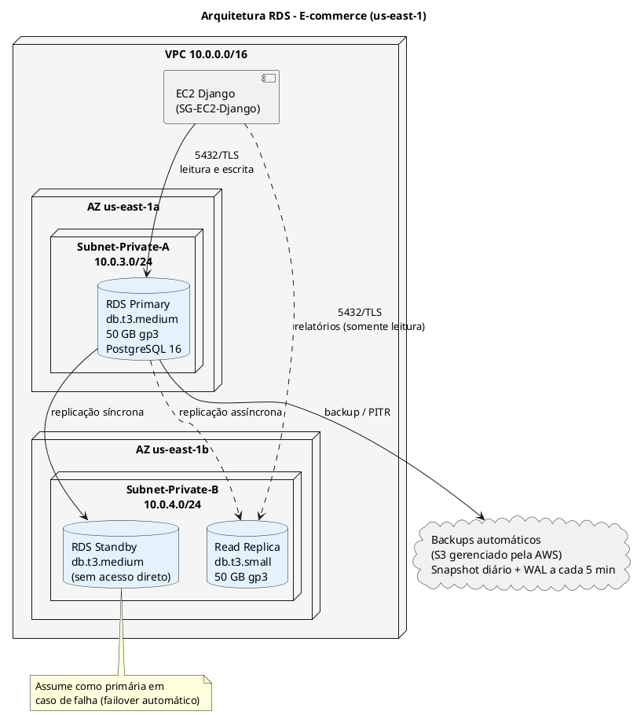
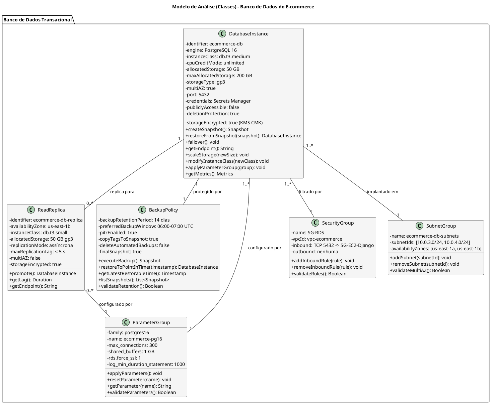
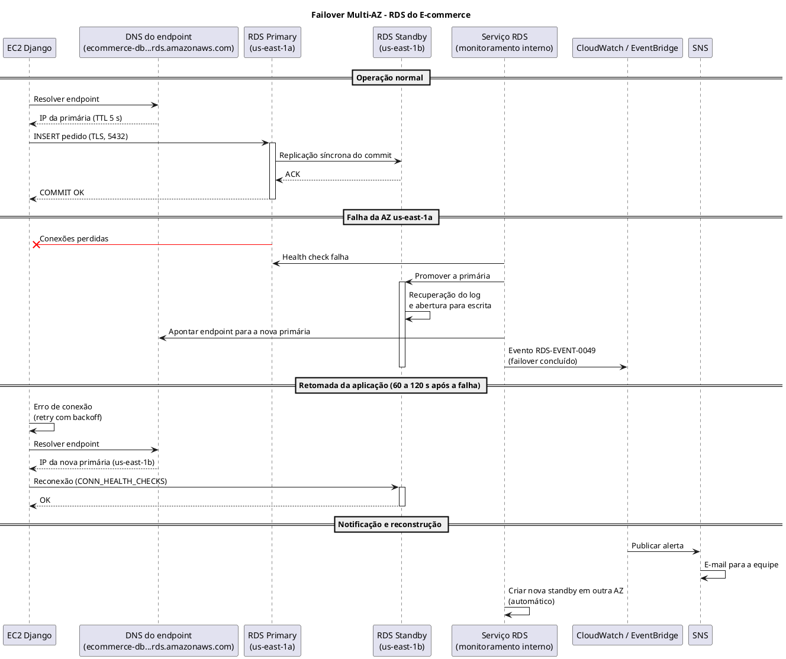
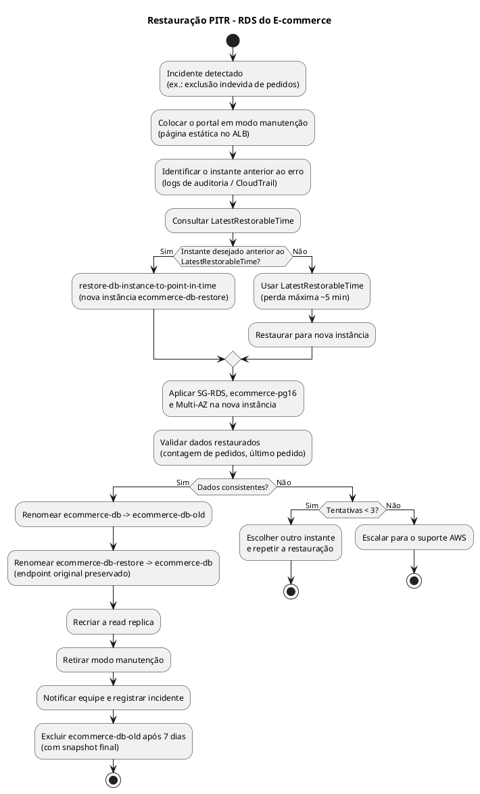

# Modelo de Análise (Classes de Análise)

## Dimensionamento de Banco de Dados (RDS)

## Plataforma de E-commerce com Arquitetura de Nuvem Híbrida e Logística Last-Mile Inteligente

---

| **Informação do Documento** | |
| :--- | :--- |
| **Projeto** | Plataforma de E-commerce com Logística Last-Mile Inteligente |
| **Documento** | Modelo de Análise (Classes de Análise) - Dimensionamento de Banco de Dados (RDS) |
| **Versão** | 1.0 |
| **Data** | 29/10/2026 |
| **Status** | Em Revisão |
| **Responsável** | Grupo E-commerce |
| **Disciplina** | Projeto de Cloud - Semana 5 |
| **Fase RUP/UP** | Elaboração (Elaboration) |

---

## 1. Introdução

### 1.1. Propósito

Este documento apresenta o **Modelo de Análise (Classes de Análise)** para o dimensionamento do banco de dados relacional **Amazon RDS for PostgreSQL** da plataforma de e-commerce. O modelo descreve as classes de análise responsáveis pela persistência dos dados transacionais (clientes, catálogo, carrinho, pedidos e pagamentos), suas responsabilidades, atributos e relacionamentos, e justifica cada decisão de dimensionamento a partir dos requisitos não funcionais do projeto.

O modelo é derivado diretamente dos seguintes artefatos:

- **Documento de Visão** (Semana 1) - Seções "Recursos do Produto (Arquitetura AWS)" e "Atributos de Qualidade"
- **Documento de Requisitos Suplementares** (Semana 2) - RNF-PER-03, RNF-ESC-03, RNF-DIS-01/02, RNF-BCP-01/02/03, RNF-SEG-02/03, RNF-CUS-01
- **Modelo de Casos de Uso Arquiteturais** (Semana 3) - UC-ARQ-001 (VPC), UC-ARQ-002 (Security Groups) e UC-ARQ-004 (Conectividade entre Camadas)
- **Modelo de Análise (Pacotes/Subsistemas)** (Semana 4) - Pacotes "Data Protection", "Secrets Management" e "Network Security"

### 1.2. Escopo

O modelo abrange o dimensionamento do banco relacional RDS PostgreSQL, incluindo:

- **Instância primária** (`DatabaseInstance`) com Multi-AZ
- **Réplica de leitura** (`ReadReplica`) para relatórios consolidados e painel do gestor
- **Política de backup** (`BackupPolicy`) com backups automáticos e PITR
- **Grupo de parâmetros** (`ParameterGroup`) customizado
- **Grupo de segurança** (`SecurityGroup`) restritivo
- **Grupo de sub-redes** (`SubnetGroup`) Multi-AZ
- **Memória de cálculo** (vCPU, memória, conexões, IOPS, storage)
- **Estimativa de custo** e comparação com alternativas

**Fora do escopo:** o DynamoDB (eventos de rastreamento logístico), que por decisão do RNF-ESC-03 não compartilha banco com as operações transacionais, e o armazenamento de imagens de produtos e comprovantes de entrega, que fica no S3.

### 1.3. Definições e Siglas

| **Sigla** | **Definição** |
| :--- | :--- |
| **RDS** | Relational Database Service - banco relacional gerenciado da AWS |
| **AZ** | Availability Zone (Zona de Disponibilidade) |
| **Multi-AZ** | Implantação com uma instância standby síncrona em outra AZ |
| **PITR** | Point-In-Time Recovery (recuperação para um instante específico) |
| **RPO** | Recovery Point Objective (perda máxima de dados aceitável) |
| **RTO** | Recovery Time Objective (tempo máximo para restabelecer o serviço) |
| **IOPS** | Input/Output Operations Per Second (operações de disco por segundo) |
| **QPS** | Queries Per Second (consultas SQL por segundo) |
| **gp3** | General Purpose SSD, 3ª geração (tipo de volume da AWS) |
| **WAL** | Write-Ahead Log (log de transações do PostgreSQL, base do PITR) |
| **ORM** | Object-Relational Mapping (camada de acesso a dados do Django) |
| **KMS** | Key Management Service (serviço de chaves de criptografia) |
| **CMK** | Customer Managed Key (chave de criptografia gerenciada pelo cliente) |
| **SG** | Security Group (firewall de instância) |
| **TLS** | Transport Layer Security (criptografia em trânsito) |
| **LGPD** | Lei Geral de Proteção de Dados (Lei nº 13.709/2018) |

### 1.4. Referências

- Documento de Visão - E-commerce (v1.0)
- Documento de Requisitos Suplementares - E-commerce (v1.0)
- Modelo de Casos de Uso Arquiteturais - E-commerce (v1.0)
- Modelo de Análise (Pacotes/Subsistemas) - E-commerce (v1.0)
- Amazon RDS for PostgreSQL - User Guide
- Amazon RDS Pricing / AWS Pricing Calculator (região us-east-1)
- AWS Well-Architected Framework - Reliability e Performance Efficiency Pillars

---

## 2. Visão Geral do Dimensionamento

### 2.1. Premissas de Carga

Os Requisitos Suplementares fixam a capacidade mínima (1.000 usuários simultâneos), mas não o volume de consultas ao banco. As premissas abaixo traduzem esse requisito em números de banco de dados e são **as mesmas usadas no dimensionamento do EC2**, para manter os dois documentos coerentes.

| **ID** | **Premissa** | **Valor** | **Origem** |
| :--- | :--- | :--- | :--- |
| P-01 | Usuários simultâneos no pico diário | 1.000 | RNF-PER-03 |
| P-02 | Intervalo médio entre requisições dinâmicas de um usuário | 5 s | Estimativa do grupo |
| P-03 | Requisições dinâmicas no pico diário | 1.000 ÷ 5 = **200 req/s** | Cálculo |
| P-04 | Fator de pico sazonal (promoções, Black Friday) | 3× → **600 req/s** | Estimativa do grupo |
| P-05 | Consultas SQL por requisição (média com ORM do Django) | 5 | Estimativa do grupo |
| P-06 | Proporção leitura / escrita | 80% / 20% | Estimativa (perfil de e-commerce) |
| P-07 | Pedidos por dia | 5.000 (normal) / 15.000 (sazonal) | Estimativa do grupo |
| P-08 | Clientes cadastrados / produtos no catálogo | 200.000 / 20.000 | Estimativa do grupo |
| P-09 | Imagens de produtos e comprovantes | Fora do banco (S3) | UC-ARQ-003 |

### 2.2. Requisitos que Impactam o Dimensionamento

| **Requisito** | **Valor** | **Fonte** |
| :--- | :--- | :--- |
| **Usuários simultâneos** | ≥ 1.000 | RNF-PER-03 |
| **Tempo de resposta do portal** | < 2 s (p95) | RNF-PER-02 |
| **Consultas ao banco (pico diário)** | 200 req/s × 5 = **1.000 QPS** | P-03, P-05 |
| **Consultas ao banco (pico sazonal)** | 600 req/s × 5 = **3.000 QPS** | P-04, P-05 |
| **Separação de cargas** | Transacional no RDS, eventos no DynamoDB | RNF-ESC-03 / RNF-DAD-01 |
| **Disponibilidade** | ≥ 99,95% | RNF-DIS-01 |
| **Redundância** | RDS Multi-AZ | RNF-DIS-02 |
| **RPO** | ≤ 15 minutos | RNF-BCP-01 |
| **RTO** | < 1 hora | RNF-BCP-02 |
| **Backup e PITR** | Habilitados | RNF-BCP-03 |
| **Criptografia em repouso** | KMS | RNF-SEG-02 |
| **Credenciais fora do código** | Secrets Manager | RNF-SEG-03 |
| **Orçamento total** | US$ 1.500/mês | RNF-CUS-01 |
| **Orçamento alocado ao RDS** | US$ 200/mês (13% do total) | Decisão do grupo |

### 2.3. Arquitetura de Banco de Dados

**Configurações gerais:** PostgreSQL 16 · criptografia AES-256 com KMS CMK · `rds.force_ssl = 1` · senha do usuário da aplicação no Secrets Manager com rotação automática · Subnet Group nas sub-redes privadas 10.0.3.0/24 e 10.0.4.0/24 · acesso somente a partir do `SG-EC2-Django`.

### 2.4. Matriz de Rastreamento

| **Requisito (Doc. Suplementar)** | **Pacote (Semana 4)** | **Classe de Análise** | **Serviço AWS** | **Configuração** |
| :--- | :--- | :--- | :--- | :--- |
| RNF-DIS-01 Disponibilidade 99,95% | Data Protection | `DatabaseInstance` | RDS Multi-AZ | `multiAZ = true` |
| RNF-DIS-02 Redundância | Network Security | `SubnetGroup` | RDS | Sub-redes em 2 AZs |
| RNF-BCP-01 RPO ≤ 15 min | Data Protection | `BackupPolicy` | RDS PITR | WAL enviado a cada 5 min |
| RNF-BCP-02 RTO < 1 h | Data Protection | `DatabaseInstance` / `BackupPolicy` | RDS | Failover automático + PITR |
| RNF-BCP-03 Backup automático | Data Protection | `BackupPolicy` | RDS | Retenção de 14 dias |
| RNF-PER-02/03 Desempenho | - | `DatabaseInstance` / `ReadReplica` | RDS | `db.t3.medium` + réplica |
| RNF-SEG-01 TLS em trânsito | Data Protection | `ParameterGroup` | RDS | `rds.force_ssl = 1` |
| RNF-SEG-02 Criptografia em repouso | Data Protection | `DatabaseInstance` | KMS | AES-256 com CMK |
| RNF-SEG-03 Credenciais | Secrets Management | `DatabaseInstance` | Secrets Manager | Rotação a cada 30 dias |
| RNF-SEG-07 LGPD (acesso restrito) | Network Security | `SecurityGroup` | VPC | 5432 só do `SG-EC2-Django` |
| RNF-OPS-01 Monitoramento | Monitoring & Detection | `DatabaseInstance` | CloudWatch / Performance Insights | Métricas e alarmes |

---

## 3. Especificação das Classes de Análise

---

### 3.1. Classe: DATABASEINSTANCE

#### 3.1.1. Responsabilidade

Representar a instância primária do RDS PostgreSQL que persiste os dados transacionais do e-commerce (clientes, catálogo, carrinho, pedidos e status de pagamento), gerenciando configuração, disponibilidade, desempenho e segurança.

#### 3.1.2. Atributos

| **Atributo** | **Tipo** | **Valor (E-commerce)** | **Justificativa** |
| :--- | :--- | :--- | :--- |
| `identifier` | String | `ecommerce-db` | Nome da instância. |
| `engine` | String | PostgreSQL 16 | Suportado nativamente pelo Django; versão com suporte padrão no RDS além do prazo do projeto. |
| `instanceClass` | String | `db.t3.medium` | 2 vCPU e 4 GB de RAM (ver seção 7.1). |
| `cpuCreditMode` | String | `unlimited` | A carga normal fica abaixo da linha de base de 20%; nos picos sazonais o excedente é cobrado, sem estrangular a CPU. |
| `allocatedStorage` | Integer | 50 GB | Volume projetado de ~20 GB em 12 meses + margem (seção 7.2). |
| `maxAllocatedStorage` | Integer | 200 GB | Storage auto scaling para crescimento imprevisto. |
| `storageType` | String | `gp3` | 3.000 IOPS e 125 MB/s de base, acima da necessidade de pico (~1.200 IOPS). |
| `multiAZ` | Boolean | `true` | RNF-DIS-01/02: standby síncrona e failover automático. |
| `storageEncrypted` | Boolean | `true` (KMS CMK `ecommerce-rds-key`) | RNF-SEG-02 e LGPD. |
| `endpoint` | String | `ecommerce-db.xxxx.us-east-1.rds.amazonaws.com` | Endpoint de instância (não é cluster Aurora); acompanha a primária no failover. |
| `port` | Integer | 5432 | Porta padrão do PostgreSQL (UC-ARQ-002). |
| `credentials` | Secret | `ecommerce/rds/app` (Secrets Manager) | RNF-SEG-03: sem senha no código; rotação a cada 30 dias. |
| `parameterGroup` | ParameterGroup | `ecommerce-pg16` | Configurações customizadas (seção 3.4). |
| `securityGroup` | SecurityGroup | `SG-RDS` | Isolamento de rede (seção 3.5). |
| `subnetGroup` | SubnetGroup | `ecommerce-db-subnets` | Sub-redes privadas em 2 AZs (seção 3.6). |
| `readReplicas` | List&lt;ReadReplica&gt; | 1 réplica | Relatórios fora da primária. |
| `backupPolicy` | BackupPolicy | `ecommerce-backup` | Seção 3.3. |
| `performanceInsights` | Boolean | `true` (7 dias) | Diagnóstico de consultas lentas, sem custo na retenção de 7 dias. |
| `publiclyAccessible` | Boolean | `false` | Banco sem IP público. |
| `autoMinorVersionUpgrade` | Boolean | `true` | Patches de segurança na janela de manutenção (domingo, 04:00-05:00 UTC). |
| `deletionProtection` | Boolean | `true` | Evita exclusão acidental. |

#### 3.1.3. Responsabilidades (Métodos)

| **Responsabilidade** | **Descrição** | **Retorno** |
| :--- | :--- | :--- |
| `createSnapshot()` | Cria snapshot manual (ex.: antes de uma migração de schema). | `Snapshot` |
| `restoreFromSnapshot(snapshot)` | Cria uma nova instância a partir de um snapshot. | `DatabaseInstance` |
| `failover()` | Promove a standby a primária (automático ou forçado com *reboot with failover*). | `void` |
| `getEndpoint()` | Retorna o endpoint de conexão. | `String` |
| `scaleStorage(newSize)` | Aumenta o storage (automático até `maxAllocatedStorage`). | `void` |
| `modifyInstanceClass(newClass)` | Escala verticalmente (ex.: antes de uma campanha). | `void` |
| `applyParameterGroup(group)` | Aplica um parameter group. | `void` |
| `getMetrics()` | Retorna CPU, conexões, IOPS, latência e créditos de CPU. | `Metrics` |

#### 3.1.4. Relacionamentos

| **Relacionamento** | **Multiplicidade** | **Descrição** |
| :--- | :--- | :--- |
| `DatabaseInstance` → `ReadReplica` | 1 : 0..* | Uma instância pode ter zero ou mais réplicas. |
| `DatabaseInstance` → `BackupPolicy` | 1 : 1 | Cada instância tem exatamente uma política de backup. |
| `DatabaseInstance` → `ParameterGroup` | 1..* : 1 | Cada instância usa um parameter group (que pode ser compartilhado com a réplica). |
| `DatabaseInstance` → `SecurityGroup` | 1..* : 1 | Cada instância é protegida pelo `SG-RDS`. |
| `DatabaseInstance` → `SubnetGroup` | 1..* : 1 | Cada instância é implantada em um subnet group. |

#### 3.1.5. Justificativa do Dimensionamento

| **Componente** | **Cálculo** | **Resultado** |
| :--- | :--- | :--- |
| **Consultas no pico diário** | 200 req/s × 5 consultas | 1.000 QPS |
| **Consultas no pico sazonal** | 600 req/s × 5 consultas | 3.000 QPS |
| **CPU por consulta (OLTP com índice)** | ~0,3 ms | Estimativa |
| **CPU no pico diário** | 1.000 × 0,3 ms = 0,3 vCPU | 15% de 2 vCPU |
| **CPU no pico sazonal** | 3.000 × 0,3 ms = 0,9 vCPU | 45% de 2 vCPU |
| **Conexões máximas** | 12 instâncias EC2 × 20 threads + 20 de reserva | 260 → `max_connections = 300` |
| **Memória necessária** | 1 GB cache + 1,5 GB conexões + 0,5 GB SO/agentes | ~3 GB → 4 GB |
| **IOPS no pico sazonal** | 900 (escrita) + 290 (leitura) | ~1.200 IOPS (40% do gp3 base) |
| **Storage em 12 meses** | 1 GB + 1,2 GB/mês × 12, + 30% overhead | ~20 GB → 50 GB alocados |
| **Instância escolhida** | 2 vCPU, 4 GB RAM | `db.t3.medium` |

#### 3.1.6. Estimativa de Custo

| **Componente** | **Configuração** | **Custo Mensal (us-east-1)** |
| :--- | :--- | :--- |
| **RDS Primary (db.t3.medium)** | Multi-AZ, US$ 0,145/h × 730 h | US$ 105,85 |
| **Storage (50 GB gp3)** | Multi-AZ, US$ 0,23/GB | US$ 11,50 |
| **Créditos de CPU (unlimited)** | ~6 vCPU-h excedentes no pico sazonal × US$ 0,075 | US$ 1,00 |
| **Secrets Manager** | 1 segredo | US$ 0,40 |
| **Performance Insights** | 7 dias de retenção | US$ 0,00 |
| **Subtotal Primary** | | **US$ 118,75** |

---

### 3.2. Classe: READREPLICA

#### 3.2.1. Responsabilidade

Representar a réplica de leitura usada pelos **relatórios consolidados** (citados no Documento de Visão) e pelas consultas pesadas do painel do gestor, para que agregações longas não disputem CPU e cache com o checkout na primária. Serve também como cópia adicional em outra AZ.

#### 3.2.2. Atributos

| **Atributo** | **Tipo** | **Valor (E-commerce)** | **Justificativa** |
| :--- | :--- | :--- | :--- |
| `identifier` | String | `ecommerce-db-replica` | Nome da réplica. |
| `sourceInstance` | DatabaseInstance | `ecommerce-db` | Instância de origem. |
| `availabilityZone` | String | `us-east-1b` | AZ diferente da primária. |
| `instanceClass` | String | `db.t3.small` | 2 vCPU e 2 GB: suficiente para relatórios, que são poucos e não concorrentes. |
| `allocatedStorage` | Integer | 50 GB gp3 | Mesmo tamanho da primária (exigência do RDS). |
| `replicationMode` | String | Assíncrona | Padrão do RDS para réplicas de leitura. |
| `maxReplicationLag` | Duration | < 5 s (alarme em 30 s) | Relatórios toleram alguns segundos de atraso. |
| `multiAZ` | Boolean | `false` | A réplica não é crítica para o checkout. |
| `storageEncrypted` | Boolean | `true` (mesma CMK) | Herdado da primária. |
| `endpoint` | String | `ecommerce-db-replica.xxxx.us-east-1.rds.amazonaws.com` | Usado pelo *database router* do Django (`using('replica')`). |

#### 3.2.3. Responsabilidades (Métodos)

| **Responsabilidade** | **Descrição** | **Retorno** |
| :--- | :--- | :--- |
| `promote()` | Promove a réplica a instância independente (cenário de desastre). | `DatabaseInstance` |
| `getLag()` | Retorna o atraso de replicação (`ReplicaLag`). | `Duration` |
| `getEndpoint()` | Retorna o endpoint de leitura. | `String` |

#### 3.2.4. Relacionamentos

| **Relacionamento** | **Multiplicidade** | **Descrição** |
| :--- | :--- | :--- |
| `ReadReplica` → `DatabaseInstance` | 0..* : 1 | Cada réplica tem exatamente uma instância de origem. |

#### 3.2.5. Justificativa do Dimensionamento

| **Componente** | **Cálculo** | **Resultado** |
| :--- | :--- | :--- |
| **Carga atendida** | Relatórios e painel do gestor (~5% das consultas, mas as mais caras) | Isola consultas longas |
| **Instância escolhida** | 2 vCPU, 2 GB RAM | `db.t3.small` |
| **Replicação** | Assíncrona | Lag típico < 1 s |
| **Uso em desastre** | Promoção manual | Alternativa ao PITR se a primária e a standby forem perdidas |

#### 3.2.6. Estimativa de Custo

| **Componente** | **Configuração** | **Custo Mensal (us-east-1)** |
| :--- | :--- | :--- |
| **Read Replica (db.t3.small)** | Single-AZ, US$ 0,036/h × 730 h | US$ 26,28 |
| **Storage (50 GB gp3)** | Single-AZ, US$ 0,115/GB | US$ 5,75 |
| **Subtotal Read Replica** | | **US$ 32,03** |

---

### 3.3. Classe: BACKUPPOLICY

#### 3.3.1. Responsabilidade

Gerenciar os backups automáticos e a recuperação do banco, garantindo o RPO de 15 minutos e o RTO inferior a 1 hora definidos nos Requisitos Suplementares.

#### 3.3.2. Atributos

| **Atributo** | **Tipo** | **Valor (E-commerce)** | **Justificativa** |
| :--- | :--- | :--- | :--- |
| `backupRetentionPeriod` | Integer | 14 dias | Cobre erros humanos descobertos em até duas semanas; menos cópias de dados pessoais (princípio de necessidade da LGPD). |
| `preferredBackupWindow` | String | `06:00-07:00 UTC` (03:00-04:00 em Brasília) | Menor movimento do e-commerce. |
| `pitrEnabled` | Boolean | `true` (implícito com retenção > 0) | O RDS envia o WAL a cada 5 minutos → RPO ≤ 5 min. |
| `copyTagsToSnapshot` | Boolean | `true` | Rastreabilidade de custos e auditoria. |
| `deleteAutomatedBackups` | Boolean | `false` | Mantém backups mesmo se a instância for excluída. |
| `finalSnapshot` | Boolean | `true` | Snapshot final obrigatório antes de qualquer exclusão. |
| `manualSnapshotPolicy` | String | Antes de cada migração de schema | Ponto de retorno garantido em deploys com `migrate`. |
| `backupTarget` | String | S3 gerenciado pela AWS (criptografado) | Armazenamento dos backups. |

#### 3.3.3. Responsabilidades (Métodos)

| **Responsabilidade** | **Descrição** | **Retorno** |
| :--- | :--- | :--- |
| `executeBackup()` | Snapshot diário automático na janela definida. | `Snapshot` |
| `restoreToPointInTime(timestamp)` | Cria uma **nova** instância no estado do instante informado. | `DatabaseInstance` |
| `getLatestRestorableTime()` | Retorna o instante mais recente recuperável (RPO real). | `Timestamp` |
| `listSnapshots()` | Lista snapshots disponíveis. | `List<Snapshot>` |
| `validateRetention()` | Verifica se a retenção está configurada conforme a política. | `Boolean` |

#### 3.3.4. Relacionamentos

| **Relacionamento** | **Multiplicidade** | **Descrição** |
| :--- | :--- | :--- |
| `BackupPolicy` → `DatabaseInstance` | 1 : 1 | Cada política está associada a uma instância. |

#### 3.3.5. Justificativa do Dimensionamento

| **Componente** | **Cálculo** | **Resultado** |
| :--- | :--- | :--- |
| **RPO real** | Upload do WAL a cada 5 min | ≤ 5 min (meta: 15 min) |
| **RTO - falha de AZ** | Failover Multi-AZ automático | 1 a 2 min |
| **RTO - corrupção/erro humano** | PITR de ~20 GB + troca de endpoint | ~30 a 40 min (meta: < 1 h) |
| **Volume de backup** | Snapshot (~20 GB) + WAL de 14 dias (~0,6 GB/dia × 14 ≈ 8,4 GB) | ~28 GB |
| **Cota gratuita de backup** | 100% do storage provisionado na região | 50 GB → sem custo |

#### 3.3.6. Estimativa de Custo

| **Componente** | **Configuração** | **Custo Mensal (us-east-1)** |
| :--- | :--- | :--- |
| **Backup automático + PITR** | ~28 GB (dentro da cota de 50 GB) | US$ 0,00 |
| **Snapshots manuais** | ~1 por mês, removidos após 30 dias | ~US$ 2,00 (US$ 0,095/GB, ~20 GB) |
| **Subtotal Backup** | | **US$ 0,00 a US$ 2,00** |

---

### 3.4. Classe: PARAMETERGROUP

#### 3.4.1. Responsabilidade

Gerenciar as configurações do PostgreSQL, ajustando memória, conexões, segurança da conexão e registro de consultas lentas ao tamanho da instância escolhida.

#### 3.4.2. Atributos

| **Atributo** | **Tipo** | **Valor (E-commerce)** | **Justificativa** |
| :--- | :--- | :--- | :--- |
| `family` | String | `postgres16` | Versão do engine. |
| `name` | String | `ecommerce-pg16` | Nome do parameter group. |
| `description` | String | "Parâmetros do banco transacional do e-commerce" | Descrição. |
| `parameters` | Map&lt;String, String&gt; | Ver tabela abaixo | Configurações. |

#### 3.4.3. Parâmetros Configurados

| **Parâmetro** | **Valor** | **Padrão RDS** | **Justificativa** |
| :--- | :--- | :--- | :--- |
| `max_connections` | 300 | Calculado pela RAM (~410) | Limite explícito: 260 conexões previstas + folga (seção 7.1). |
| `shared_buffers` | 1 GB | ~25% da RAM | Cache de páginas do PostgreSQL (25% de 4 GB). |
| `effective_cache_size` | 3 GB | ~50-75% da RAM | Informa ao planejador o cache total disponível. |
| `work_mem` | 4 MB | 4 MB | Mantido: 300 conexões × 4 MB não excede a RAM. |
| `maintenance_work_mem` | 256 MB | 64 MB | Acelera `VACUUM` e criação de índices. |
| `random_page_cost` | 1.1 | 4.0 | Volume SSD (gp3): acesso aleatório quase tão barato quanto sequencial. |
| `rds.force_ssl` | 1 | 0 | RNF-SEG-01: recusa conexões sem TLS. |
| `idle_in_transaction_session_timeout` | 60000 (60 s) | 0 | Libera conexões presas por transações abertas. |
| `log_min_duration_statement` | 1000 (1 s) | -1 | Registra consultas lentas no CloudWatch Logs. |
| `log_statement` | `ddl` | `none` | Auditoria de alterações de schema. |
| `timezone` | `UTC` | `UTC` | Mantido: o Django grava datas em UTC (`USE_TZ = True`) e converte para `America/Sao_Paulo` na exibição. |

#### 3.4.4. Responsabilidades (Métodos)

| **Responsabilidade** | **Descrição** | **Retorno** |
| :--- | :--- | :--- |
| `applyParameters()` | Aplica os parâmetros (alguns exigem reboot). | `void` |
| `resetParameter(name)` | Restaura o valor padrão. | `void` |
| `getParameter(name)` | Retorna o valor de um parâmetro. | `String` |
| `validateParameters()` | Verifica se a soma de memória cabe na instância. | `Boolean` |

#### 3.4.5. Relacionamentos

| **Relacionamento** | **Multiplicidade** | **Descrição** |
| :--- | :--- | :--- |
| `ParameterGroup` → `DatabaseInstance` | 1 : 1..* | O mesmo parameter group é usado pela primária e pela réplica. |

#### 3.4.6. Estimativa de Custo

| **Componente** | **Configuração** | **Custo Mensal** |
| :--- | :--- | :--- |
| **Parameter Group** | Customizado | US$ 0,00 (gratuito) |
| **Subtotal Parameter Group** | | **US$ 0,00** |

---

### 3.5. Classe: SECURITYGROUP

#### 3.5.1. Responsabilidade

Controlar o acesso de rede ao RDS, permitindo apenas conexões vindas das instâncias da aplicação Django na porta 5432, conforme o UC-ARQ-002.

#### 3.5.2. Atributos

| **Atributo** | **Tipo** | **Valor (E-commerce)** | **Justificativa** |
| :--- | :--- | :--- | :--- |
| `name` | String | `SG-RDS` | Nome definido no UC-ARQ-002. |
| `vpcId` | String | `vpc-ecommerce` (10.0.0.0/16) | VPC do projeto (UC-ARQ-001). |
| `description` | String | "Acesso ao PostgreSQL somente pela aplicação" | Descrição. |
| `inboundRules` | List&lt;Rule&gt; | Ver tabela abaixo | Regras de entrada. |
| `outboundRules` | List&lt;Rule&gt; | Nenhuma | O SG é *stateful*: respostas às conexões de entrada já são permitidas. |

#### 3.5.3. Regras de Entrada

| **Protocolo** | **Porta** | **Origem** | **Descrição** |
| :--- | :--- | :--- | :--- |
| TCP | 5432 | `SG-EC2-Django` | Somente a aplicação Django acessa o banco. |

Não há regra para a Lambda de ingestão: pelo RNF-ESC-03, ela grava apenas no DynamoDB.

#### 3.5.4. Regras de Saída

| **Protocolo** | **Porta** | **Destino** | **Descrição** |
| :--- | :--- | :--- | :--- |
| - | - | - | Nenhuma saída necessária. |

#### 3.5.5. Responsabilidades (Métodos)

| **Responsabilidade** | **Descrição** | **Retorno** |
| :--- | :--- | :--- |
| `addInboundRule(rule)` | Adiciona regra de entrada. | `void` |
| `removeInboundRule(rule)` | Remove regra de entrada. | `void` |
| `validateRules()` | Verifica se não há origem `0.0.0.0/0`. | `Boolean` |

#### 3.5.6. Relacionamentos

| **Relacionamento** | **Multiplicidade** | **Descrição** |
| :--- | :--- | :--- |
| `SecurityGroup` → `DatabaseInstance` | 1 : 1..* | O `SG-RDS` protege a primária e a réplica. |

#### 3.5.7. Estimativa de Custo

| **Componente** | **Configuração** | **Custo Mensal** |
| :--- | :--- | :--- |
| **Security Group** | `SG-RDS` | US$ 0,00 (gratuito) |
| **Subtotal Security Group** | | **US$ 0,00** |

---

### 3.6. Classe: SUBNETGROUP

#### 3.6.1. Responsabilidade

Definir as sub-redes privadas onde o RDS pode ser implantado, garantindo isolamento da internet e a distribuição Multi-AZ.

#### 3.6.2. Atributos

| **Atributo** | **Tipo** | **Valor (E-commerce)** | **Justificativa** |
| :--- | :--- | :--- | :--- |
| `name` | String | `ecommerce-db-subnets` | Nome do subnet group. |
| `description` | String | "Sub-redes privadas do RDS Multi-AZ" | Descrição. |
| `subnetIds` | List&lt;String&gt; | `subnet-priv-a` (10.0.3.0/24), `subnet-priv-b` (10.0.4.0/24) | Sub-redes privadas do UC-ARQ-001. |
| `availabilityZones` | List&lt;String&gt; | `us-east-1a`, `us-east-1b` | Multi-AZ. |
| `vpcId` | String | `vpc-ecommerce` | VPC do projeto. |

#### 3.6.3. Responsabilidades (Métodos)

| **Responsabilidade** | **Descrição** | **Retorno** |
| :--- | :--- | :--- |
| `addSubnet(subnetId)` | Adiciona sub-rede ao grupo. | `void` |
| `removeSubnet(subnetId)` | Remove sub-rede do grupo. | `void` |
| `validateMultiAZ()` | Verifica se há sub-redes em pelo menos 2 AZs. | `Boolean` |

#### 3.6.4. Relacionamentos

| **Relacionamento** | **Multiplicidade** | **Descrição** |
| :--- | :--- | :--- |
| `SubnetGroup` → `DatabaseInstance` | 1 : 1..* | O subnet group é usado pela primária, standby e réplica. |

#### 3.6.5. Estimativa de Custo

| **Componente** | **Configuração** | **Custo Mensal** |
| :--- | :--- | :--- |
| **Subnet Group** | 2 sub-redes privadas | US$ 0,00 (gratuito) |
| **Subtotal Subnet Group** | | **US$ 0,00** |

---

## 4. Diagrama de Classes (PlantUML)

---

## 5. Diagrama de Sequência - Failover Multi-AZ

No RDS Multi-AZ o failover é conduzido pelo próprio serviço: ele detecta a falha, promove a standby e aponta o endpoint DNS para ela. O CloudWatch e o SNS apenas **observam e notificam**, não comandam o failover.

---

## 6. Diagrama de Atividades - Restauração PITR

O PITR sempre cria uma **nova instância**. Para não alterar a configuração da aplicação, a instância restaurada recebe o nome da original após a validação, mantendo o mesmo endpoint.

**Tempo estimado:** 10 min de diagnóstico + 15 a 20 min de restauração (~20 GB) + 10 min de validação e troca de nome = **35 a 40 min**, dentro do RTO de 1 hora (RNF-BCP-02).

---

## 7. Memória de Cálculo

### 7.1. Cálculo de vCPU, Memória e Conexões

| **Métrica** | **Fórmula** | **Cálculo** | **Resultado** |
| :--- | :--- | :--- | :--- |
| **Requisições no pico diário** | Usuários ÷ intervalo | 1.000 ÷ 5 s | 200 req/s |
| **Requisições no pico sazonal** | Pico diário × 3 | 200 × 3 | 600 req/s |
| **QPS no pico diário** | req/s × consultas | 200 × 5 | 1.000 QPS |
| **QPS no pico sazonal** | req/s × consultas | 600 × 5 | 3.000 QPS |
| **CPU no pico diário** | QPS × 0,3 ms | 1.000 × 0,0003 s | 0,3 vCPU (15%) |
| **CPU no pico sazonal** | QPS × 0,3 ms | 3.000 × 0,0003 s | 0,9 vCPU (45%) |
| **Linha de base do t3.medium** | 20% por vCPU | 2 × 20% | 0,4 vCPU |
| **Conexões da aplicação** | Máx. EC2 × threads por EC2 | 12 × 20 | 240 |
| **Conexões de reserva** | Admin, migrações, monitoramento | - | 20 |
| **max_connections** | 240 + 20, arredondado | 260 → 300 | 300 |
| **Memória para cache** | `shared_buffers` | 25% de 4 GB | 1 GB |
| **Memória para conexões** | 300 × ~5 MB | 1.500 MB | 1,5 GB |
| **Memória para SO e agentes RDS** | - | - | 0,5 GB |
| **Memória total** | 1 + 1,5 + 0,5 | 3 GB | 3 GB → **4 GB** |
| **Instância escolhida** | 2 vCPU, 4 GB | - | `db.t3.medium` |

O `db.t3.small` (2 GB) não comporta a memória calculada. O pico diário (15% de CPU) fica abaixo da linha de base de 20% do t3. Apenas o pico sazonal (45%) consome créditos, cobrados no modo `unlimited`.

### 7.2. Cálculo de Storage e IOPS

| **Métrica** | **Fórmula** | **Cálculo** | **Resultado** |
| :--- | :--- | :--- | :--- |
| **Clientes** | 200.000 × 2 KB | 400 MB | 0,4 GB |
| **Catálogo (sem imagens)** | 20.000 × 4 KB | 80 MB | 0,08 GB |
| **Dados iniciais + índices** | (0,48 GB + sessões e tabelas auxiliares) × 2 | - | ~1 GB |
| **Pedidos por mês** | 5.000 × 30 | 150.000 | 150.000 |
| **Tamanho por pedido** | Pedido 1 KB + 3 itens × 0,5 KB + pagamento 0,5 KB + entrega 1 KB | 4 KB | 4 KB |
| **Crescimento mensal (com índices)** | 150.000 × 4 KB × 2 | 1,2 GB | 1,2 GB/mês |
| **Volume em 12 meses** | (1 + 1,2 × 12) × 1,3 de overhead | 15,4 × 1,3 | ~20 GB |
| **Storage alocado** | Volume em 12 meses × 2,5 de margem | - | 50 GB (auto scaling até 200 GB) |
| **Escritas no pico sazonal** | 3.000 QPS × 20% | 600 escritas/s | 600/s |
| **IOPS de escrita** | 600 × 1,5 (WAL + gravação de páginas) | - | 900 IOPS |
| **Leituras no pico sazonal** | 3.000 QPS × 80% | 2.400 leituras/s | 2.400/s |
| **IOPS de leitura** | 2.400 × 3% (falta no cache) × 4 páginas | - | ~290 IOPS |
| **IOPS necessários (pico sazonal)** | 900 + 290 | - | **~1.200 IOPS** |
| **IOPS disponíveis (gp3, < 400 GB)** | Valor fixo do RDS | - | 3.000 IOPS / 125 MB/s |

**Observação:** o gp3 **não possui burst** (o modelo de referência cita 16.000 IOPS de burst, o que vale para o antigo gp2). No RDS, volumes gp3 abaixo de 400 GB entregam 3.000 IOPS fixos, o que dá **2,5× de folga** sobre o pico sazonal calculado.

### 7.3. Cálculo de Disponibilidade

| **Métrica** | **Fórmula** | **Cálculo** | **Resultado** |
| :--- | :--- | :--- | :--- |
| **SLA desejado** | - | - | 99,95% |
| **Indisponibilidade mensal permitida** | (1 - 0,9995) × 30 dias | 0,0005 × 43.200 min | 21,6 min |
| **Indisponibilidade anual permitida** | (1 - 0,9995) × 365 dias | 0,0005 × 525.600 min | 262,8 min (4,38 h) |
| **SLA do RDS Multi-AZ (AWS)** | - | - | 99,95% |
| **Duração de um failover** | - | - | 1 a 2 min |
| **Failovers comportados por mês** | 21,6 ÷ 2 | - | ~10 |
| **RPO - failover Multi-AZ** | Replicação síncrona | - | 0 |
| **RPO - PITR** | Envio do WAL a cada 5 min | - | ≤ 5 min (meta 15 min) ✅ |
| **RTO - falha de AZ** | Failover automático | - | ≤ 2 min ✅ |
| **RTO - corrupção lógica** | PITR (seção 6) | - | ~40 min (meta < 1 h) ✅ |

### 7.4. Estimativa de Custo Total

Preços de referência sob demanda na região us-east-1, conferidos na AWS Pricing Calculator. Podem variar com a data da consulta.

| **Componente** | **Configuração** | **Custo Mensal** |
| :--- | :--- | :--- |
| **RDS Primary (db.t3.medium)** | Multi-AZ | US$ 105,85 |
| **Storage Primary (50 GB gp3)** | Multi-AZ | US$ 11,50 |
| **Créditos de CPU (unlimited)** | Pico sazonal | US$ 1,00 |
| **Read Replica (db.t3.small)** | Single-AZ | US$ 26,28 |
| **Storage Replica (50 GB gp3)** | Single-AZ | US$ 5,75 |
| **Backup automático + PITR** | ~28 GB, dentro da cota gratuita | US$ 0,00 |
| **Secrets Manager** | 1 segredo com rotação | US$ 0,40 |
| **Performance Insights** | 7 dias | US$ 0,00 |
| **Parameter / Security / Subnet Group** | - | US$ 0,00 |
| **TOTAL** | | **US$ 150,78/mês** |

**Percentual do orçamento total:** US$ 150,78 ÷ US$ 1.500 = **10,1%** (dentro dos US$ 200 alocados ao RDS).

---

## 8. Trade-offs Documentados

| **Decisão** | **Alternativa** | **Prós** | **Contras** | **Impacto no Custo** |
| :--- | :--- | :--- | :--- | :--- |
| **`db.t3.medium` (unlimited)** | `db.m6g.large` (2 vCPU, 8 GB) | t3: atende à carga calculada pela metade do preço. | t3: depende de créditos de CPU; m6g: desempenho constante e mais memória. | t3: US$ 106; m6g: ~US$ 222 |
| **Multi-AZ** | Single-AZ | Failover automático, RPO 0, exigido pelo RNF-DIS-02. | Dobra o custo da instância. | +US$ 53/mês |
| **Read Replica** | Sem réplica | Relatórios não disputam recursos com o checkout. | Custo adicional e lag de replicação. | +US$ 32/mês |
| **gp3** | io1 / io2 | gp3: 3.000 IOPS fixos, mais barato. | io1: só se o IOPS passar de ~3.000. | gp3: US$ 11,50; io1: > US$ 100 |
| **Retenção de 14 dias** | 30 dias | Menos cópias de dados pessoais; cabe na cota gratuita. | Recuperação limitada a 2 semanas atrás. | US$ 0 nos dois casos (dentro da cota) |
| **us-east-1** | sa-east-1 (São Paulo) | us-east-1: preços menores e mesma região do modelo da disciplina. | sa-east-1: menor latência para clientes no Brasil (~110-130 ms a menos por ida e volta) e dados no país. | sa-east-1 costuma custar 40-60% mais (conferir na AWS Pricing Calculator) |
| **Conexões diretas (Django `CONN_MAX_AGE`)** | RDS Proxy | Sem custo extra; 300 conexões cabem na instância. | Proxy ajudaria com muitos picos de conexão. | Proxy: +~US$ 22/mês |

---

## 9. Riscos e Mitigações

| **Risco** | **Probabilidade** | **Impacto** | **Mitigação** |
| :--- | :--- | :--- | :--- |
| **Esgotamento de conexões** | Média | Alto | `max_connections = 300`, `CONN_MAX_AGE = 60` no Django, alarme em `DatabaseConnections > 240`. |
| **Esgotamento de créditos de CPU** | Média | Médio | Modo `unlimited` + alarme em `CPUUtilization > 70%`; subir para `db.m6g.large` antes de campanhas grandes (`modifyInstanceClass`). |
| **Storage insuficiente** | Baixa | Alto | Storage auto scaling até 200 GB + alarme em `FreeStorageSpace < 10 GB`. |
| **Falha da AZ primária** | Baixa | Alto | Multi-AZ com failover automático (1-2 min). |
| **Perda ou corrupção de dados** | Baixa | Crítico | PITR (RPO ≤ 5 min), snapshot manual antes de migrações, `deletionProtection`. |
| **Lag alto da réplica** | Média | Baixo | Alarme em `ReplicaLag > 30 s`; relatórios toleram atraso. |
| **Custo acima do orçamento** | Baixa | Médio | AWS Budgets com alertas em 70%, 85% e 100% (RNF-CUS-02). |
| **Acesso não autorizado** | Baixa | Crítico | Sub-rede privada, `SG-RDS` restrito, TLS obrigatório, credenciais no Secrets Manager. |
| **Consultas lentas (N+1 do ORM)** | Média | Médio | `log_min_duration_statement`, Performance Insights e `select_related` no Django. |

---

## 10. Considerações Finais

### 10.1. Lições Aprendidas

- O requisito de **1.000 usuários simultâneos** só vira dimensionamento de banco depois de convertido em **consultas por segundo** e **conexões**. As premissas da seção 2.1 tornam esse cálculo explícito.
- O número de conexões é limitado pela camada de computação (EC2 × threads), por isso este documento e o de EC2 devem usar as mesmas premissas.
- **Multi-AZ** resolve a falha de infraestrutura (RPO 0), mas não protege contra erro lógico: para isso é necessário o **PITR**.
- O volume gp3 no RDS não tem burst; o dimensionamento de IOPS deve usar o valor fixo de 3.000.
- O RDS custa cerca de **10% do orçamento**, deixando margem para EC2, transferência de dados e serviços serverless.

### 10.2. Próximos Passos

- **Semana 6:** Dimensionamento de Computação (EC2) - `ComputeInstance`, `AutoScalingGroup`, `LoadBalancer`.
- **Semana 7:** Consolidação da Arquitetura - diagramas de sequência e de comunicação dos fluxos críticos.
- **Semana 10:** Estratégias de deploy (Modelo de Design - Atividades).
- Validar as premissas P-02 e P-05 com um teste de carga quando o portal estiver implantado.

---

## 11. Aprovações

| **Função** | **Nome** | **Data** | **Assinatura** |
| :--- | :--- | :--- | :--- |
| Arquiteto de Soluções | | | |
| Arquiteto de Banco de Dados | | | |
| Professor Responsável | | | |
| Coordenador do Curso | | | |

---

## 12. Histórico de Versões

| **Versão** | **Data** | **Autor** | **Descrição das Alterações** |
| :--- | :--- | :--- | :--- |
| 0.1 | 29/10/2026 | Grupo E-commerce | Criação do documento a partir do modelo SwiftTrack. |
| 1.0 | 29/10/2026 | Grupo E-commerce | Premissas de carga, classes, diagramas, memória de cálculo e custos do e-commerce. |
