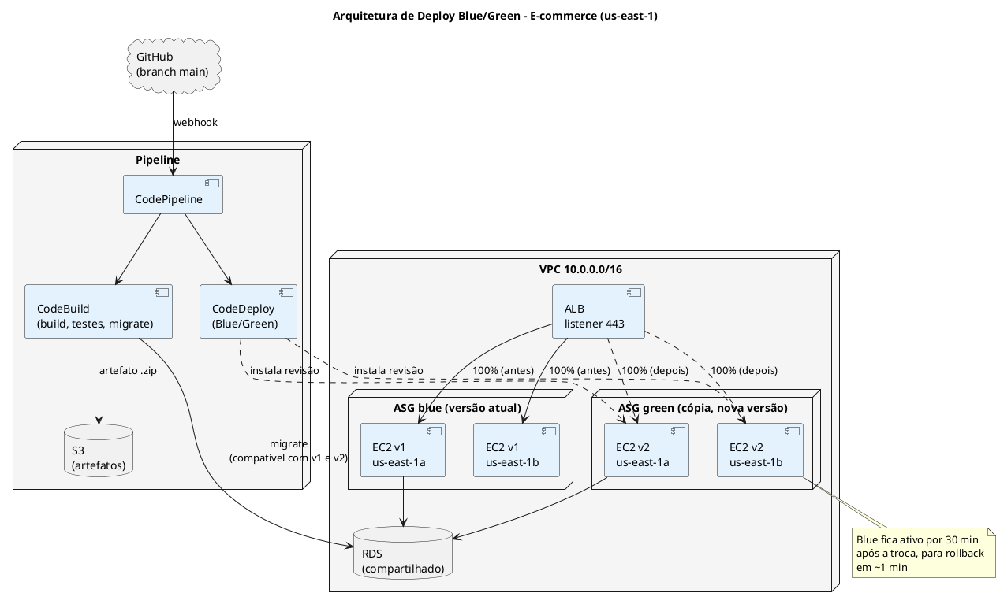
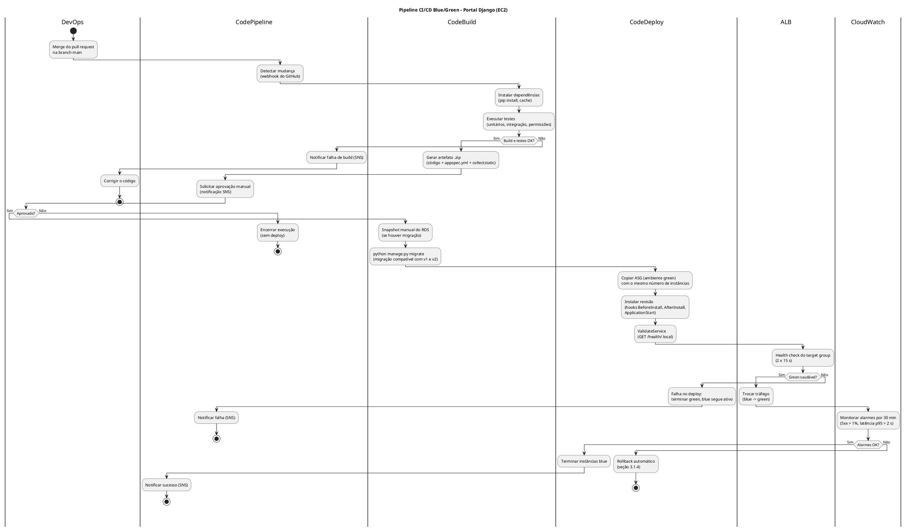
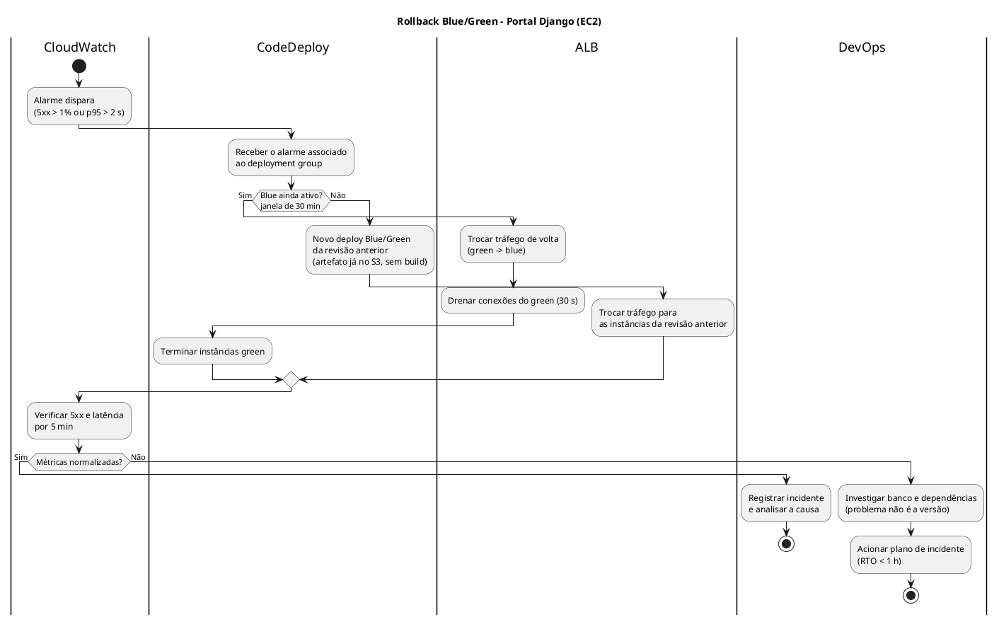
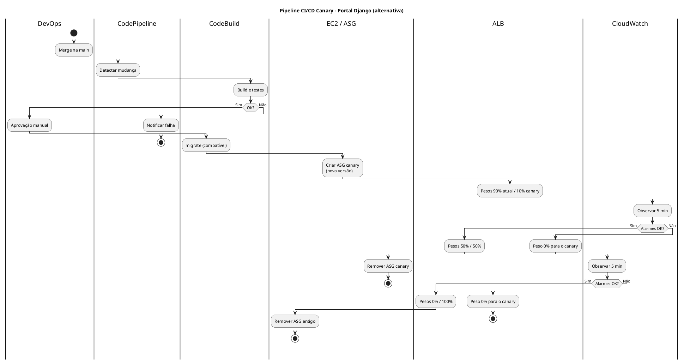
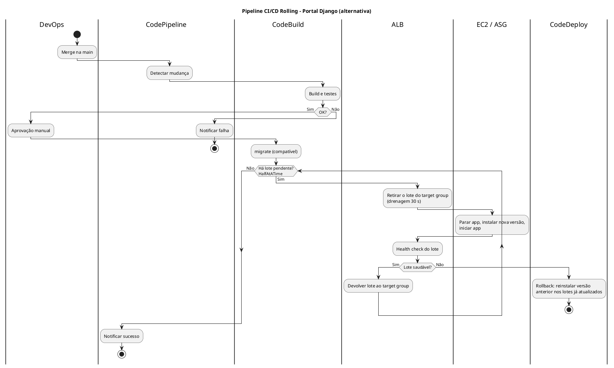
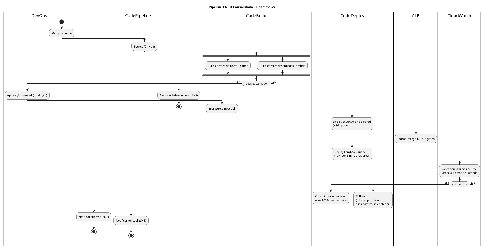

# Modelo de Design (Diagramas de Atividades)

## Estratégias de Deploy

## Plataforma de E-commerce com Arquitetura de Nuvem Híbrida e Logística Last-Mile Inteligente

---

| **Informação do Documento** | |
| :--- | :--- |
| **Projeto** | Plataforma de E-commerce com Logística Last-Mile Inteligente |
| **Documento** | Modelo de Design (Diagramas de Atividades) - Estratégias de Deploy |
| **Versão** | 1.0 |
| **Data** | 29/10/2026 |
| **Status** | Em Revisão |
| **Responsável** | Grupo E-commerce |
| **Disciplina** | Projeto de Cloud - Semana 10 |
| **Fase RUP/UP** | Construção / Transição (Construction / Transition) |

---

## 1. Introdução

### 1.1. Propósito

Este documento apresenta o **Modelo de Design (Diagramas de Atividades)** das estratégias de deploy da plataforma de e-commerce. Ele compara as estratégias **Blue/Green**, **Canary** e **Rolling**, escolhe a mais adequada para cada camada e modela, em diagramas de atividades com raias (*swimlanes*), o pipeline de CI/CD e o rollback.

O documento é derivado dos seguintes artefatos:

- **Documento de Requisitos Suplementares** (Semana 2) - RNF-DIS-01, RNF-BCP-02, RNF-MAN-01/02/03, RNF-CUS-01
- **Modelo de Casos de Uso Arquiteturais** (Semana 3) - UC-ARQ-006 (Pipeline de CI/CD): deploy < 10 min, rollback < 5 min, aprovação manual
- **Modelo de Análise (Pacotes/Subsistemas)** (Semana 4) - Pacotes "Audit & Compliance" e "Monitoring & Detection"
- **Modelo de Análise (Classes) - EC2** (Semana 6) - `AutoScalingGroup`, `LaunchTemplate`, `TargetGroup`
- **Modelo de Design (Consolidação Arquitetural)** (Semana 7) - Fluxo 7 (Deploy automatizado)

### 1.2. Escopo

- Deploy do **portal e API Django** nas instâncias EC2 do Auto Scaling Group (estratégia principal deste documento).
- Deploy das **funções Lambda** da ingestão logística (estratégia complementar, seção 3.4).
- Migrações de schema do banco executadas como etapa do pipeline.

**Fora do escopo:** mudanças de infraestrutura (VPC, RDS, ALB), que são aplicadas pela ferramenta de IaC (RNF-MAN-02), e a atualização mensal da AMI base, tratada por *Instance Refresh* no documento de EC2 (seção 7).

### 1.3. Definições e Siglas

| **Sigla** | **Definição** |
| :--- | :--- |
| **CI/CD** | Continuous Integration / Continuous Delivery (integração e entrega contínuas) |
| **Blue/Green** | Duas cópias do ambiente; o tráfego é trocado de uma vez da antiga (*blue*) para a nova (*green*) |
| **Canary** | A nova versão recebe primeiro uma pequena parte do tráfego, que aumenta aos poucos |
| **Rolling** | As instâncias existentes são atualizadas em lotes, sem ambiente paralelo |
| **ASG** | Auto Scaling Group |
| **ALB** | Application Load Balancer |
| **AppSpec** | Arquivo `appspec.yml` que define os passos (*hooks*) do CodeDeploy na instância |
| **IaC** | Infrastructure as Code (infraestrutura como código) |
| **RTO** | Recovery Time Objective |
| **SLA** | Service Level Agreement |
| **SNS** | Simple Notification Service |

### 1.4. Referências

- Documento de Requisitos Suplementares - E-commerce (v1.0)
- Modelo de Casos de Uso Arquiteturais - E-commerce (v1.0)
- Modelo de Análise (Pacotes/Subsistemas) - E-commerce (v1.0)
- Modelo de Análise (Classes) - EC2 - E-commerce (v1.0)
- Modelo de Design (Consolidação Arquitetural) - E-commerce (v1.0)
- AWS CodeDeploy User Guide - *Blue/green deployments on an EC2/On-Premises compute platform*
- AWS CodePipeline / CodeBuild Documentation
- AWS Well-Architected Framework - Operational Excellence Pillar

---

## 2. Visão Geral das Estratégias de Deploy

### 2.1. Requisitos que Impactam o Deploy

| **Requisito** | **Valor** | **Fonte** |
| :--- | :--- | :--- |
| **Disponibilidade** | ≥ 99,95% (21,6 min/mês de indisponibilidade permitida) | RNF-DIS-01 |
| **RTO** | < 1 hora | RNF-BCP-02 |
| **Tempo de deploy** | < 10 minutos | UC-ARQ-006 |
| **Tempo de rollback** | < 5 minutos | UC-ARQ-006 |
| **Aprovação manual para produção** | Obrigatória | UC-ARQ-006 (passo 7) |
| **Rollback automático em falha** | Obrigatório | UC-ARQ-006 (passo 5, Alt 2) |
| **Pipeline integrado ao GitHub** | CodePipeline | RNF-MAN-03 |
| **Capacidade no pico** | 4 instâncias (diário) / 12 (sazonal) | Documento de EC2 |
| **Orçamento total** | US$ 1.500/mês | RNF-CUS-01 |
| **Orçamento para o pipeline** | US$ 20/mês | Decisão do grupo |
| **Frequência de deploys** | ~20 por mês | Estimativa do grupo |

**Como o tempo de deploy é medido:** da aprovação manual até 100% do tráfego na nova versão. O build e os testes acontecem antes da aprovação, e o tempo de espera por um humano não é controlável pelo pipeline.

### 2.2. Comparação das Estratégias de Deploy

| **Critério** | **Rolling** (CodeDeploy *in-place*, metade por vez) | **Blue/Green** (CodeDeploy, cópia do ASG) | **Canary** (ALB com pesos) |
| :--- | :--- | :--- | :--- |
| **Suporte nativo no CodeDeploy para EC2** | Sim | Sim | Não (exige orquestração própria) |
| **Tempo de deploy (após aprovação)** | ~5 min | ~6 min | ~20 min |
| **Tempo de rollback** | ~5 min (reinstala a versão anterior) | ~1 min (volta o tráfego para o *blue*) | < 1 min (peso 0 para a nova versão) |
| **Capacidade durante o deploy** | Cai para 50% | 100% (ambientes em paralelo) | 100% |
| **Versões misturadas atendendo usuários** | Sim, durante o deploy | Não | Sim, por desenho |
| **Detecção de erros com tráfego real** | Tardia | Após a troca, com rollback rápido | Precoce (só 10% afetados) |
| **Custo por deploy** | ~US$ 0,05 | ~US$ 0,10 | ~US$ 0,15 + orquestração |
| **Complexidade** | Baixa | Média | Alta |
| **Atende deploy < 10 min** | ✅ | ✅ | ❌ |
| **Atende rollback < 5 min** | ⚠️ No limite | ✅ | ✅ |
| **Escolha para o portal (EC2)** | ❌ | ✅ | ❌ |

### 2.3. Arquitetura de Deploy

---

## 3. Especificação das Estratégias

---

### 3.1. ESTRATÉGIA ESCOLHIDA (PORTAL EC2): BLUE/GREEN

#### 3.1.1. Descrição

O CodeDeploy cria uma **cópia do Auto Scaling Group** (ambiente *green*) com o mesmo Launch Template e a mesma quantidade de instâncias do ambiente atual (*blue*). Ele instala a nova revisão, valida a saúde das instâncias e **troca o tráfego do ALB de uma vez** para o *green*. O *blue* continua ligado por **30 minutos**: se algum alarme disparar nesse período, o tráfego volta para ele em cerca de 1 minuto. Passado o prazo, o *blue* é terminado.

As **migrações de banco** rodam antes da troca, em uma etapa do CodeBuild dentro da VPC. Por isso, devem ser **compatíveis com as duas versões** (padrão *expand/contract*: adicionar colunas numa versão e remover as antigas só na seguinte).

#### 3.1.2. Justificativa da Escolha

| **Requisito** | **Valor** | **Blue/Green atende?** | **Justificativa** |
| :--- | :--- | :--- | :--- |
| **SLA 99,95%** | 21,6 min/mês | ✅ Sim | A troca não derruba o serviço; capacidade total durante o deploy. |
| **Deploy** | < 10 min | ✅ Sim | ~6 min da aprovação ao tráfego no *green* (tabela 3.1.5). |
| **Rollback** | < 5 min | ✅ Sim | ~1 min dentro da janela de 30 min; ~5 min depois dela (novo deploy da revisão anterior, sem rebuild). |
| **Rollback automático** | UC-ARQ-006 | ✅ Sim | CodeDeploy reverte se o deploy falhar ou se um alarme do CloudWatch disparar. |
| **Capacidade no pico** | 4 a 12 instâncias | ✅ Sim | O *green* é criado com o mesmo tamanho do *blue*. |
| **Custo** | ≤ US$ 20/mês | ✅ Sim | ~US$ 0,10 por deploy → ~US$ 2,20/mês (seção 6). |

O modelo de referência estimava ~US$ 50 por deploy, mas a tabela de atividades do próprio modelo somava ~US$ 0,05. A diferença está no tempo em que os dois ambientes ficam ligados juntos. Aqui ele foi calculado explicitamente: 2 instâncias extras por ~35 minutos.

#### 3.1.3. Diagrama de Atividades - Pipeline Blue/Green

#### 3.1.4. Diagrama de Atividades - Rollback

#### 3.1.5. Tabela de Atividades

| **#** | **Swimlane** | **Atividade** | **Descrição** | **Tempo** | **Custo** |
| :--- | :--- | :--- | :--- | :--- | :--- |
| 1 | DevOps | Merge na `main` | Pull request revisado e aprovado. | - | US$ 0 |
| 2 | CodePipeline | Detectar mudança | Webhook do GitHub. | 0,5 min | US$ 0,001 |
| 3 | CodeBuild | Build e testes | Dependências em cache + testes. | 4 min | US$ 0,020 |
| 4 | CodePipeline | Aprovação manual | Espera humana (fora da medição). | - | US$ 0 |
| **-** | **-** | **Início da medição do deploy** | | | |
| 5 | CodeBuild | Snapshot + migrate | Somente se houver migração. | 1 min | US$ 0,005 |
| 6 | CodeDeploy | Copiar ASG e lançar *green* | AMI base pré-configurada. | 1,5 min | - |
| 7 | CodeDeploy | Instalar revisão | Hooks do `appspec.yml`. | 1 min | - |
| 8 | CodeDeploy / ALB | Validar saúde | `ValidateService` + 2 health checks de 15 s. | 1 min | - |
| 9 | ALB | Trocar tráfego | Listener aponta para o *green*; drenagem de 30 s. | 1 min | - |
| 10 | CodePipeline | Ações do pipeline | Cobrança por minuto de ação (V2). | - | US$ 0,022 |
| **-** | **-** | **Fim da medição: tráfego 100% no green** | | **~6 min** | |
| 11 | CloudWatch | Janela de observação | *Blue* ligado por 30 min para rollback. | 30 min | - |
| 12 | CodeDeploy | Terminar *blue* | Fim do deploy. | 0,5 min | - |
| - | EC2 | Instâncias em paralelo | 2 instâncias × ~35 min × US$ 0,0416/h. | - | US$ 0,049 |
| **Total** | | | | **~6 min** (deploy) | **~US$ 0,10** |

#### 3.1.6. Riscos e Mitigações

| **Risco** | **Probabilidade** | **Impacto** | **Mitigação** |
| :--- | :--- | :--- | :--- |
| Migração quebra a versão *blue* (rollback impossível) | Média | Alto | Padrão *expand/contract*; snapshot manual antes; migrações destrutivas só na versão seguinte. |
| Deploy em horário de pico dobra instâncias | Média | Baixo | Deploys fora das 20h-22h; custo extra limitado a ~35 min. |
| Deploy durante campanha sazonal | Baixa | Alto | Congelamento de deploys nos dias de campanha. |
| Falta de capacidade de EC2 na AZ ao criar o *green* | Baixa | Médio | Deploy falha antes da troca; *blue* continua atendendo. |
| Sessões de usuários perdidas na troca | Baixa | Baixo | Sessões no RDS, não na instância. |
| Rollback não testado | Média | Alto | Simular rollback em homologação a cada mês. |

---

### 3.2. ESTRATÉGIA ALTERNATIVA: CANARY

#### 3.2.1. Descrição

A nova versão sobe em um segundo ASG e o ALB passa a dividir o tráfego por **pesos** entre dois target groups: 10% para a nova versão por 5 minutos, depois 50% por 5 minutos e, se os alarmes estiverem normais, 100%. Para EC2, o CodeDeploy **não oferece Canary nativo**, então a troca de pesos teria de ser orquestrada (por exemplo, com uma função Lambda chamada pelo pipeline).

#### 3.2.2. Diagrama de Atividades - Pipeline Canary

#### 3.2.3. Comparação Canary vs Blue/Green

| **Critério** | **Canary** | **Blue/Green** | **Vencedor (portal EC2)** |
| :--- | :--- | :--- | :--- |
| **Tempo de deploy** | ~20 min (5 + 5 + ~10 de preparação) | ~6 min | Blue/Green |
| **Rollback** | < 1 min | ~1 min | Empate |
| **Usuários expostos a um erro** | 10% por até 5 min | 100% até o alarme (minutos) | Canary |
| **Suporte nativo (CodeDeploy EC2)** | Não | Sim | Blue/Green |
| **Volume de tráfego para validar 10%** | Fora de pico: ~6 req/s no canary, pouco para detectar erro em 5 min | Não se aplica | Blue/Green |
| **Complexidade para equipe de 3 pessoas** | Alta | Média | Blue/Green |

O Canary perde no portal principalmente pelo **tempo de deploy (> 10 min)** e pela falta de suporte nativo. Ele é a escolha certa, porém, para a camada **Lambda** (seção 3.4), onde o CodeDeploy oferece Canary pronto.

---

### 3.3. ESTRATÉGIA ALTERNATIVA: ROLLING

#### 3.3.1. Descrição

O CodeDeploy atualiza as **próprias instâncias** do ASG em lotes (configuração `HalfAtATime`): retira metade do ALB, instala a nova versão, valida e devolve, depois repete com a outra metade. Não há ambiente paralelo, então é a opção mais barata, mas a capacidade cai pela metade durante o deploy e o rollback exige reinstalar a versão anterior.

#### 3.3.2. Diagrama de Atividades - Pipeline Rolling

#### 3.3.3. Comparação Rolling vs Blue/Green

| **Critério** | **Rolling** | **Blue/Green** | **Vencedor (portal EC2)** |
| :--- | :--- | :--- | :--- |
| **Tempo de deploy** | ~5 min (2 lotes × ~2,5 min) | ~6 min | Rolling (por pouco) |
| **Rollback** | ~5 min (reinstalação) | ~1 min | Blue/Green |
| **Capacidade durante o deploy** | 50% (no pico diário: 2 instâncias para 200 req/s → 100% de CPU) | 100% | Blue/Green |
| **Versões misturadas** | Sim | Não | Blue/Green |
| **Custo por deploy** | ~US$ 0,05 | ~US$ 0,10 | Rolling (diferença de ~US$ 1/mês) |

O Rolling economizaria cerca de **US$ 1 por mês**, mas deixaria o portal com metade da capacidade durante o deploy e com rollback no limite dos 5 minutos. A diferença de custo não compensa o risco ao SLA.

---

### 3.4. ESTRATÉGIA PARA A CAMADA SERVERLESS (LAMBDA): CANARY NATIVO

As funções `ingestao-eventos` e `gerar-url-comprovante` são publicadas como **versões** e acessadas por um **alias** (`prod`). O CodeDeploy usa a configuração `LambdaCanary10Percent5Minutes`: 10% das invocações vão para a nova versão por 5 minutos e, se o alarme de erros da Lambda não disparar, o alias passa a apontar 100% para ela.

| **Critério** | **Valor** | **Atende?** |
| :--- | :--- | :--- |
| Tempo de deploy | ~6 min (5 min de canary + publicação) | ✅ < 10 min |
| Rollback | Alias volta para a versão anterior em segundos | ✅ < 5 min |
| Custo | Sem infraestrutura paralela (só invocações) | ✅ ~US$ 0 |
| Volume para validar 10% | 10 eventos/s × 10% × 300 s = ~300 eventos no canary | ✅ Suficiente para detectar erro |

---

## 4. Diagrama de Atividades Consolidado

Visão única do pipeline (Build → Test → Deploy → Validation → Rollback), com as duas camadas.

---

## 5. Matriz de Rastreamento

| **Requisito** | **Caso de Uso** | **Pacote** | **Classe** | **Estratégia** | **Diagrama** |
| :--- | :--- | :--- | :--- | :--- | :--- |
| Deploy < 10 min | UC-ARQ-006 | Audit & Compliance | `AutoScalingGroup`, `LaunchTemplate` | Blue/Green (~6 min) | 3.1.3 |
| Rollback < 5 min | UC-ARQ-006 | Monitoring & Detection | `TargetGroup`, `LoadBalancer` | Blue/Green (~1 min) | 3.1.4 |
| Rollback automático | UC-ARQ-006 (Alt 2) | Monitoring & Detection | `Alarm` | CodeDeploy + alarmes do CloudWatch | 3.1.4, 4 |
| Aprovação manual | UC-ARQ-006 (passo 7) | Identity & Access | `Pipeline` | Etapa de aprovação do CodePipeline | 3.1.3 |
| RNF-DIS-01 (99,95%) | UC-ARQ-004 | Network Security | `LoadBalancer`, `AutoScalingGroup` | Blue/Green (capacidade 100%) | 2.3, 3.1.3 |
| RNF-MAN-01/03 (Git + CodePipeline) | UC-ARQ-006 | Audit & Compliance | `Pipeline` | Todas | 4 |
| RNF-BCP-01 (RPO) em migrações | UC-ARQ-006 | Data Protection | `BackupPolicy` | Snapshot antes do `migrate` | 3.1.3 |
| RNF-ESC-02 (camada serverless) | UC-ARQ-004 | - | `LambdaFunction` | Canary nativo da Lambda | 3.4, 4 |
| RNF-CUS-01 (orçamento) | - | - | - | ~US$ 2,20/mês | 6 |

---

## 6. Estimativas de Tempo e Custo

Base: 20 deploys por mês, ASG com 2 instâncias (fora de pico), preços de referência em us-east-1.

### 6.1. Blue/Green (escolhida para o portal)

| **Item** | **Tempo** | **Custo** |
| :--- | :--- | :--- |
| Build e testes (antes da aprovação) | 4,5 min | US$ 0,021 |
| Deploy (aprovação → tráfego no *green*) | ~6 min | US$ 0,027 (CodeBuild + CodePipeline) |
| Instâncias em paralelo (*blue* + *green*) | ~35 min | US$ 0,049 |
| Rollback | ~1 min (na janela) / ~5 min (depois) | ~US$ 0 |
| **Por deploy** | | **~US$ 0,10** |
| **Por mês (20 deploys + artefatos no S3)** | | **~US$ 2,20** |

### 6.2. Canary (alternativa)

| **Item** | **Tempo** | **Custo** |
| :--- | :--- | :--- |
| Deploy | ~20 min | US$ 0,05 (pipeline) |
| Instâncias em paralelo | ~25 min | US$ 0,035 |
| Orquestração dos pesos (Lambda + manutenção) | - | Esforço de desenvolvimento |
| Rollback | < 1 min | ~US$ 0 |
| **Por deploy** | | **~US$ 0,15** (sem contar o esforço de manutenção) |

### 6.3. Rolling (alternativa)

| **Item** | **Tempo** | **Custo** |
| :--- | :--- | :--- |
| Deploy | ~5 min | US$ 0,05 (pipeline) |
| Instâncias em paralelo | 0 | US$ 0 |
| Rollback | ~5 min | ~US$ 0 |
| **Por deploy** | | **~US$ 0,05** |

### 6.4. Lambda (Canary nativo)

| **Item** | **Tempo** | **Custo** |
| :--- | :--- | :--- |
| Publicação + canary | ~6 min | ~US$ 0,01 |
| Rollback | Segundos | US$ 0 |

---

## 7. Considerações Finais

### 7.1. Lições Aprendidas

- A estratégia de deploy **não precisa ser a mesma para todas as camadas**: Blue/Green no EC2 e Canary na Lambda usam o que cada serviço oferece de forma nativa.
- O custo do Blue/Green depende de **quanto tempo os dois ambientes ficam ligados juntos**. Calculado explicitamente, fica em centavos por deploy, e não nos ~US$ 50 do modelo de referência.
- Definir **como medir** o tempo de deploy (a partir da aprovação) evita que a espera humana estoure a meta de 10 minutos.
- O ponto mais arriscado de qualquer estratégia é o **banco compartilhado**: migrações precisam ser compatíveis com a versão anterior para que o rollback funcione.
- Rolling seria o mais barato, mas a perda de 50% da capacidade em horário de pico compromete o SLA.

### 7.2. Próximos Passos

- Criar `buildspec.yml`, `appspec.yml` e o deployment group Blue/Green no CodeDeploy (UC-ARQ-006).
- Associar ao deployment group os alarmes de 5xx e latência definidos no UC-ARQ-005.
- Testar o rollback em homologação e medir os tempos reais.
- Descrever o pipeline em IaC (RNF-MAN-02).

---

## 8. Aprovações

| **Função** | **Nome** | **Data** | **Assinatura** |
| :--- | :--- | :--- | :--- |
| Arquiteto de Soluções | | | |
| Engenheiro de DevOps | | | |
| Professor Responsável | | | |
| Coordenador do Curso | | | |

---

## 9. Histórico de Versões

| **Versão** | **Data** | **Autor** | **Descrição das Alterações** |
| :--- | :--- | :--- | :--- |
| 0.1 | 29/10/2026 | Grupo E-commerce | Criação do documento a partir do modelo SwiftTrack. |
| 1.0 | 29/10/2026 | Grupo E-commerce | Comparação das estratégias, diagramas de atividades, tabela de atividades e estimativas. |
